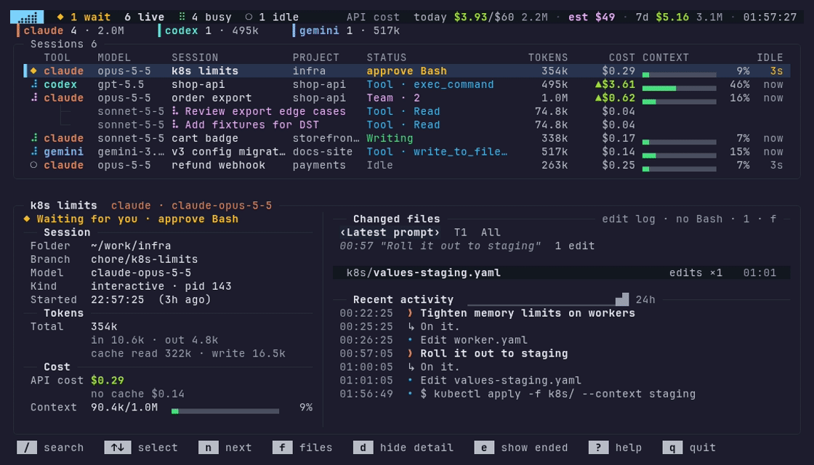

# ⣠⣴⣾ aitop

[](https://www.npmjs.com/package/@sejuneoh/aitop)
[](https://github.com/SejuneOh/aitop/blob/main/LICENSE)

**`top` for your AI coding agents.** A read-only terminal monitor that shows every Claude Code, Codex CLI and Antigravity CLI session on your machine in one live screen: what each one is doing, which ones are waiting for you, and how many tokens they used.



- **Live status** of every session and its subagents: thinking, running a tool, waiting for you, idle
- **Waiting alerts**: blocked sessions jump to the top, with optional bell, desktop notification or hook command
- **Tokens and cost** per session and for today / last 7 days, at public API list prices
- **Changed files and diffs** per session and per prompt
- **Read-only**: no network, no ports, no dependencies. It only reads the session logs each CLI already writes

> The UI follows your locale: English by default, Korean when the locale starts with `ko`. Set `AITOP_LANG=ko|en` (or `--lang`) to pick one. This covers the live screen, `--once`, `--help`, `--doctor`, error messages and desktop notifications. Keys and options work the same in both.

## Install

Requires Node.js 22+ on Linux, macOS or WSL.

```bash
npm install -g @sejuneoh/aitop
aitop
```

## Usage

```
aitop            live screen
aitop --all      include sessions that ended in the last 24 hours
aitop --json     print a snapshot as JSON and exit
aitop --doctor   check which tools and logs aitop can see
aitop --line     print one short status line and exit (for tmux, e.g. $54.13/$50 wait 2 run 3 $3.1/h)
aitop --report daily  daily cost table and exit
aitop --help     all options
aitop --lang ko  Korean screen, help, doctor and error messages (also AITOP_LANG=ko or "lang": "ko" in the config file)
```

The language is picked from `--lang`, then `AITOP_LANG`, then `lang` in the config file, then `LC_ALL`, `LC_MESSAGES` and `LANG`: Korean when the locale starts with `ko`, English otherwise (including `C.UTF-8` and unset). If you used aitop on a `C.UTF-8` or `en_US` locale before, the screen, help and doctor output are now in English; set `AITOP_LANG=ko` to keep Korean.

In `--json`, `phase` stays the Korean status text in every language (as does `AITOP_WAITING_FOR` for `--on-waiting`). For scripts, use `phaseKind`, a stable state name: `think`, `write`, `tool`, `team`, `waiting`, `idle`, `done`, `ended` (or `null`). Other text fields follow their own rules: with English selected, `--doctor --json` has Korean `tools.*.hint` but English `config.problems`.

### Daily report

`aitop --report daily` prints tokens and cost (API list price, like the header) per day, newest first, with a total row, then exits. Columns are per tool by default or per model with `--by model`; `--days N` goes back up to 30 days, and `--json` gives the same numbers for scripts. The first run reads up to 30 days of logs, so it can take a while (progress shows on stderr); later runs use the cache.

```
aitop --report daily --by model --days 14
```

### tmux status line

`aitop --line` prints today's cost (API list price, `/$<budget>` when a daily budget is set), the number of sessions waiting for you (`wait 2`, Claude Code counted live), the number of sessions running (`run 3`), and spend over the last hour. Items that are 0 are left out, and `--line-width N` (default 40) drops items from the end. It reads only aitop's cache, so it is fast once `aitop` has run before; with no cache yet it prints `...` after about 1.5 seconds. The running count (and waiting Antigravity sessions) come from a small summary that the live screen, `--once` and `--json` write to the cache; when no summary is newer than 60 seconds, `run` is left out rather than shown wrong. `--line=tmux` adds tmux colors, `NO_COLOR` turns them off.

```tmux
set -g status-right '#(aitop --line=tmux)'
set -g status-interval 15
```

Keys: `↑↓` select · `n` next session to check · `/` search · `s` sort · `g` group · `p` pin · `f` changed files · `?` help · `q` quit

Settings can also go in `~/.config/aitop/config.json`. See `aitop --help` or the [detailed manual (Korean)](https://github.com/SejuneOh/aitop/blob/main/docs/README.ko.md).

## License

[MIT](https://github.com/SejuneOh/aitop/blob/main/LICENSE)
