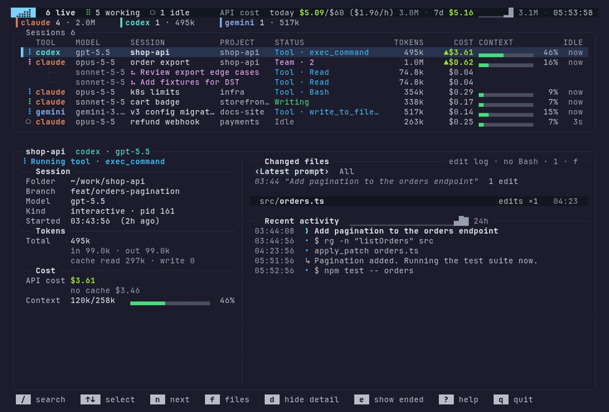

# ⣠⣴⣾ aitop

[](https://www.npmjs.com/package/@sejuneoh/aitop)
[](https://github.com/SejuneOh/aitop/blob/main/LICENSE)

**`top` for your AI coding agents.** One live terminal screen for every Claude Code, Codex CLI and Antigravity CLI session on your machine. No hooks, read-only.

```bash
npx @sejuneoh/aitop          # try it, no install
npm i -g @sejuneoh/aitop     # then just run: aitop
```



- **See who needs you.** A waiting session jumps to the top and `n` takes you there. Add `--notify=waiting,done,context` for desktop alerts, or `aitop --line` for a tmux status line.
- **Know which session is which.** Every row shows the session name (your `/rename` or the tool's title). `y` copies a resume command, and `--report sessions` prints yesterday's sessions with cost for your standup.
- **No hooks, nothing sent.** Claude Code, Codex CLI and Antigravity CLI side by side, from [several history folders](#several-claude-or-codex-profiles) (`~/.claude`, `~/.claude-work`, ...). aitop only reads the logs they already write. It changes no settings and needs no network, ports or dependencies.

**How it differs from similar tools**

- [ccusage](https://github.com/ryoppippi/ccusage) reports token usage and cost from local logs (daily, monthly, session, 5-hour blocks). aitop is a live session monitor first, with smaller cost reports on the side.
- [abtop](https://github.com/graykode/abtop) is a Rust live dashboard for Claude Code, Codex CLI and OpenCode, with rate limits, ports and keys to kill sessions. aitop installs with npm, also covers Antigravity, and only watches.
- [claude-code-monitor](https://github.com/onikan27/claude-code-monitor) watches Claude Code on macOS through hooks it adds to `~/.claude/settings.json`, with a phone web view. aitop adds no hooks and only reads existing logs, on Linux, macOS, WSL and Windows.
- [Agents Stack](https://marketplace.visualstudio.com/items?itemName=MykD.agents-stack) is a VS Code extension for Claude Code, Antigravity, Codex and Gemini CLI. It adds hooks to each agent's config, and Antigravity has no hook for approval waits, so those do not show. aitop runs in any terminal, adds no hooks and shows Antigravity sessions waiting for approval.

## Install

Requires Node.js 22+ on Linux, macOS, WSL or Windows.

```bash
npx @sejuneoh/aitop              # run the latest version without installing
npm install -g @sejuneoh/aitop   # or install it
aitop
```

Native Windows support is early (Windows Terminal recommended): Claude Code and Codex sessions, `--once`, `--json`, `--report` and `--doctor` work, but process detection, desktop notifications and `--on-waiting` are not there yet ([#195](https://github.com/SejuneOh/aitop/issues/195)-[#197](https://github.com/SejuneOh/aitop/issues/197)). Until then a Codex session counts as running while its log was written in the last 10 minutes, so it drops out during a long step that writes nothing for over 10 minutes, and a crashed session can stay up to 10 minutes. Cache, log and config live in `%LOCALAPPDATA%\aitop\cache`, `%LOCALAPPDATA%\aitop\state` and `%APPDATA%\aitop` unless `XDG_*` is set.

## Features

- **Live status** of every session and its subagents: thinking, running a tool, waiting for you, idle, or stopped by an error (`! Login needed`, `! Connection lost`, read from the API error lines Claude Code already logs; it sorts right under waiting and pinned sessions and never counts as done). Subagent rows show how long they have run ([details](#subagents))
- **Prompt cache countdown** for Claude sessions waiting on you or idle: `cache 3:12` after the status text (warning color under a minute, dim `cache expired` after), estimated from the log's `cache_creation` 5m/1h tokens and the last request start, per the [prompt caching docs](https://platform.claude.com/docs/en/build-with-claude/prompt-caching). Dropped first on narrow screens; `--json` has `cacheExpiresAt`
- **Tool run time** while a session runs a tool: `Tool · Bash · 4m12s`, from the open tool call's start (Claude `tool_use`, Codex `function_call`, Antigravity running step). Shown after one minute, dim warning color from ten minutes (Claude Code's Bash timeout max), not counted while waiting for approval. Dropped first on narrow screens; `--json` has `toolStartedAt`
- **Waiting alerts**: blocked sessions jump to the top, with optional bell, desktop notification or hook command
- **Tokens and cost** per session and for today / last 7 days, estimated at public API list prices. This is not your bill
- **Changed files and diffs** per session and per prompt
- **Read-only**: no network, no ports, no dependencies. It only reads the session logs each CLI already writes

> The UI follows your locale: English by default, Korean when the locale starts with `ko`. Set `AITOP_LANG=ko|en` (or `--lang`) to pick one. This covers the live screen, `--once`, `--help`, `--doctor`, error messages and desktop notifications. Keys and options work the same in both.

## Usage

```
aitop            live screen
aitop --all      include sessions that ended in the last 24 hours
aitop --json     print a snapshot as JSON and exit
aitop --doctor   check which tools and logs aitop can see
aitop --line     print one short status line and exit (for tmux, e.g. $54.13 wait 2 fix-login 3m run 3 $3.1/h)
aitop --report daily  daily cost table and exit
aitop --report monthly  monthly cost table (last 12 months) and exit
aitop --report sessions  yesterday's sessions with cost, for standups (--md, --json)
aitop --help     all options
aitop --lang ko  Korean screen, help, doctor and error messages (also AITOP_LANG=ko or "lang": "ko" in the config file)
```

The language is picked from `--lang`, then `AITOP_LANG`, then `lang` in the config file, then `LC_ALL`, `LC_MESSAGES` and `LANG`: Korean when the locale starts with `ko`, English otherwise (including `C.UTF-8` and unset). If you used aitop on a `C.UTF-8` or `en_US` locale before, the screen, help and doctor output are now in English; set `AITOP_LANG=ko` to keep Korean.

To continue a session elsewhere (for example when you cannot jump to its tab, as in Windows Terminal with WSL), the detail panel shows a `Resume` command and `y` copies it to the clipboard with OSC 52: Claude `cd <dir> && claude --resume <id>`, Codex `cd <dir> && codex resume <id>`, Antigravity `cd <dir> && agy --conversation <id>` (none for Gemini CLI). A session from a data folder other than `~/.claude` / `~/.codex` (or any session while `CLAUDE_CONFIG_DIR` / `CODEX_HOME` is set) gets `CLAUDE_CONFIG_DIR=<dir>` / `CODEX_HOME=<dir>` before the tool so it finds the right history. Claude finds sessions per folder, so without a known folder no command is made; ids that are not UUIDs make none either. A short detail panel leaves the command out; use `y` or `--json` then. Paths and ids are shell quoted and control characters are stripped. Windows Terminal, WezTerm, iTerm2 and kitty accept OSC 52; tmux needs `set -g set-clipboard on`; other terminals ignore it silently, so copy the command from the panel. Nothing is sent to the session. `--json` has the same command as `resumeCmd` per session (`null` if none).

In `--json`, `phase` stays the Korean status text in every language (as does `AITOP_WAITING_FOR` for `--on-waiting`). Session `name` uses the same user-given names as the table: a Codex session's `name` changes from the folder name to its `thread_name` once it has one. For scripts, use `phaseKind`, a stable state name: `think`, `write`, `tool`, `team`, `waiting`, `idle`, `stopped`, `done`, `ended` (or `null`). `stopped` is an idle Claude session whose last log entry is an API error; `stopReason` then says why (`{ "kind": "auth" }` login needed, `network` connection lost, `api` any other API error), `null` otherwise. Other text fields follow their own rules: with English selected, `--doctor --json` has Korean `tools.*.hint` but English `config.problems`.

### Subagents

Subagents show as `├─` rows under their session. While one works, its row shows how long it has run (`42s`, `3m12s`, `1h05m`).

A dim `stalled?` appears when a working subagent's log has not changed for 3 minutes. While it runs a tool that can be slow (Bash, PowerShell, a nested agent, web fetch or search, an MCP tool, agy `run_command`), the limit is 10 minutes. It is only a guess. It never shows while the session waits for you, and it does not change sorting, alerts, the window title or `--line`. `--json` has it per member as `stalled`, with `startedAt` and `lastActivityAt`.

When an Antigravity subagent waits for your approval, its parent row waits too, as `<agent>: <tool>`. So the session jumps to the top and counts for `n`, `--notify` and `--line`. If the parent waits itself, its own wait shows first. Other waiting subagents show on their own rows.

### Daily report

`aitop --report daily` prints tokens and cost (API list price, like the header) per day, newest first, with a total row, then exits. Columns are per tool by default, per model with `--by model`, or per project with `--by project` (the last folder name of the working directory: Claude log `cwd`, Codex `turn_context.cwd`, agy workspace; Claude Code worktrees under `<repo>/.claude/worktrees/` count as the repo; `(unknown)` when missing; extra columns beyond the terminal width are merged into `(others)`, `--json` lists all with a `paths` map); `--days N` goes back up to 30 days, and `--json` gives the same numbers for scripts. The first run reads up to 30 days of logs, so it can take a while (progress shows on stderr); later runs use the cache.

```
aitop --report daily --by model --days 14
aitop --report daily --by project --days 7
```

`aitop --report monthly [--by tool|model|project] [--months N] [--json]` prints the same per month, newest first, for up to 12 months. Past days are folded into `monthly.json` in the cache folder (`~/.cache/aitop`, outside the versioned cache) about two days later, so monthly totals survive cache rebuilds and Claude Code deleting old transcripts. The first run reads up to a year of remaining logs once. `*` marks this month, `~` a month only partly counted (for example before the oldest remaining Claude log), and `no data` a month with neither logs nor archive (unknown, not zero). The archive keeps token counts per type, so costs are recomputed when the price table changes. In `--json`, rows have `month`, `current` and `status` (`complete`, `partial` or `missing`).

```
aitop --report monthly --by model --months 6
```

### Session report

`aitop --report sessions [--since yesterday|today|Nd|YYYY-MM-DD] [--plan USD] [--md|--json] [--show-prompts]` lists every session that used tokens in the period (default: since midnight yesterday; at most 30 days back), highest cost first: tool, main model (`+N` more), project (same rule as `--by project`), session name (your `/rename` name, then the tool's title, then the folder), start and end of activity within the period, tokens, cost (API list price; unpriced models are left out, not guessed, and `--json` marks them with `unpriced`) and files changed (`-` when unknown, always for agy). A summary card on top shows the total, the share per tool and the session count; `--plan 200` adds how many times the period's share of a $200/month subscription (period days / 30) you used, still in API list price and not your bill. Claude subagents are counted in their parent session. `--md` prints Markdown you can paste (`|` and line breaks escaped), `--json` the same numbers for scripts. First prompts are hidden unless you pass `--show-prompts`, so they do not end up in shared output (session names still show).

```
aitop --report sessions --md --plan 200
aitop --report sessions --since 7d --json
```

### Notifications

Off by default and only on the live screen. Sessions already waiting (or already over 90% context) when aitop starts are not reported.

```
aitop --notify                       desktop notification when a session starts waiting (notify-send on Linux/WSL, osascript on macOS)
aitop --notify=waiting,done,context  pick the kinds; plain --notify uses the config file kinds, or waiting only when none are set
aitop --on-waiting 'my-hook.sh'      run a command with /bin/sh -c for the same events (10 second limit, runs as you)
```

- `waiting`: a session starts waiting for your approval or answer.
- `done`: a session that was busy for over 3 minutes in one turn (config `doneMinutes`; time spent waiting for approval does not count) goes idle and stays idle for 5 seconds. Brief idle gaps between tool calls, approval waits, ended sessions, subagents, sessions stopped by an API error and sessions whose status is guessed from file times are not reported. Once per turn.
- `context`: context use passes 90%, once; it re-arms after it drops below 85% (for example after compaction).

The hook keeps its name: it gets `AITOP_EVENT` (`waiting`, `done` or `context`) plus `AITOP_TOOL`, `AITOP_PROJECT`, `AITOP_SESSION_ID`, `AITOP_CWD` and `AITOP_WAITING_FOR` in its environment. Config file: `"notify": true` or `"notify": ["waiting", "done", "context"]`, `"onWaiting": "..."` (file must be `chmod 600`), `"doneMinutes": 5`. Plain `--notify` keeps the kinds from the config `notify` list (waiting only when there is none). `--no-notify` turns off only the desktop notification: the hook still follows those kinds. `--bell` stays waiting only.

The notification body shows the session's own name when it has one (Claude Code `/rename`, or a name given by a peer session; Codex `thread_name`), otherwise the project. Desktop notifications can appear on the lock screen, so the name is visible there too.

### tmux status line

`aitop --line` prints today's cost (API list price, `/$<budget>` when a daily budget is set), the sessions waiting for you with the longest waiting one's name and wait time (`wait fix-login 3m` for one, `wait 2 fix-login 3m` for more; Claude Code read live, names cut to 12 columns with `~`), the number of sessions running (`run 3`), and spend over the last hour. Items that are 0 are left out, and `--line-width N` (default 40) drops items from the end (the waiting name goes before the waiting count; with a daily budget and a waiting name, `$/h` often does not fit in 40, so raise `--line-width` to keep it). It reads only aitop's cache, so it is fast once `aitop` has run before; with no cache yet it prints `...` after about 1.5 seconds. The running count (and waiting Antigravity sessions with their names) come from a small summary that the live screen, `--once` and `--json` write to the cache; when no summary is newer than 60 seconds, `run` is left out rather than shown wrong. `--line=tmux` adds tmux colors, `NO_COLOR` turns them off.

Session names come from your sessions, so in tmux always use `--line=tmux`: it escapes `#` in names, while plain output could let tmux expand a `#{...}` or `#(...)` inside a name. In a zsh prompt with `PROMPT_SUBST`, a `%` in a name can be expanded by zsh, so escape `%` (for example `${$(aitop --line)//\%/%%}`) or use the line only in tmux.

```tmux
set -g status-right '#(aitop --line=tmux)'
set -g status-interval 15
```

Keys: `↑↓` select · `n` next session to check · `/` search · `s` sort · `g` group · `p` pin · `f` changed files · `?` help · `q` quit

Settings can also go in `~/.config/aitop/config.json` (`%APPDATA%\aitop\config.json` on Windows). See `aitop --help` or the [detailed manual (Korean)](https://github.com/SejuneOh/aitop/blob/main/docs/README.ko.md).

### Several Claude or Codex profiles

aitop reads `~/.claude` and `~/.codex` by default. To read more profiles, list them in the config file, `"claudeDirs": ["~/.claude", "~/.claude-work"]` and `"codexHomes": ["~/.codex", "~/.codex-alt"]`, or set `AITOP_CLAUDE_DIRS` / `AITOP_CODEX_HOMES` with paths joined by `:` (`;` on Windows), for example `AITOP_CLAUDE_DIRS=~/.claude:~/.claude-work aitop`. Order: `AITOP_*` > config file > an inherited `CLAUDE_CONFIG_DIR` / `CODEX_HOME` > default, so a `CLAUDE_CONFIG_DIR` exported for Claude Code does not hide your config list; `aitop --print-config` shows which source is used. A value that is itself an existing folder is never split, so an old single path containing `:` keeps working. The same folder listed twice (also through a link) is read once, and a session log copied into two folders is counted once. For monthly reports, a month counts as complete only from the day after the oldest remaining log of the folder that was cleaned most recently, so a folder with old logs cannot make a month look complete when another folder already lost logs for it. aitop does not read look-alike folders on its own; `aitop --doctor` lists every folder it reads plus folders that hold logs but are not read (`~/.claude-*`, `~/.config/claude`, `~/.codex-*` and similar owned by you, and a `CLAUDE_CONFIG_DIR` / `CODEX_HOME` the config list left out), with how to add them.

## License

[MIT](https://github.com/SejuneOh/aitop/blob/main/LICENSE)

Not affiliated with or endorsed by Anthropic, OpenAI or Google. Product names are trademarks of their owners.
