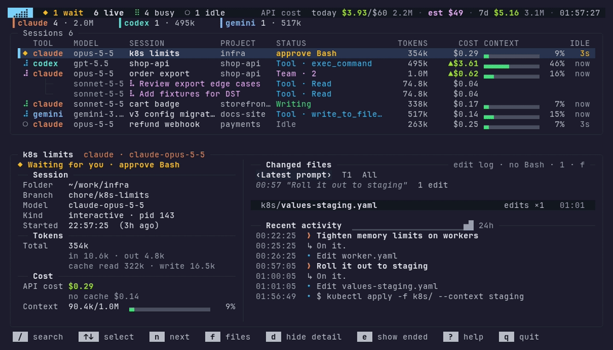

# ⣠⣴⣾ aitop

터미널에서 지금 돌고 있는 AI 코딩 세션(Claude Code · Codex CLI · Antigravity CLI · Gemini CLI)과 진행 내용, 토큰을 실시간으로 보는 읽기 전용 모니터.



- 포트를 열지 않고, 네트워크 요청을 하지 않는다. 각 CLI 가 내 PC 에 남기는 세션 파일만 읽는다.
- 세션 파일은 읽기 전용으로만 연다. 디스크에 쓰는 곳은 읽은 위치·합계를 기억하는 `~/.cache/aitop` 뿐이다 (지워도 된다). `--debug` 를 켰을 때만 디버그 로그를 따로 쓴다.
- 화면에 표시되는 텍스트 중 API 키·토큰처럼 보이는 값은 `••••` 로 가린다.
- 외부 라이브러리 없음 (Node 22 이상). Antigravity CLI 의 세부 정보는 Node 내장 `node:sqlite` 로 기록을 immutable(파일을 하나도 만들거나 고치지 않는 열기)로 열 수 있는 Node 22.15 이상에서만 읽는다.

## 설치

npmjs.com 에 공개로 올린다 (MIT).

```bash
npm install -g @sejuneoh/aitop   # 설치·업데이트
aitop
```

예전에 비공개 GitHub Packages 에서 설치했다면 그 레지스트리 설정을 지워야 npmjs.com 에서 받는다.

```bash
npm config delete @sejuneoh:registry
npm config delete //npm.pkg.github.com/:_authToken
```

로컬 코드로 바로 써 보려면 저장소에서 `npm install -g .`

## 릴리스

| 브랜치 | 하는 일 |
|---|---|
| 기능 브랜치 → `dev` | PR 마다 CI(단위 테스트 → e2e → 실행 확인 → `npm pack` 설치 확인, Node 22/22.13/22.15/24, macOS 22) 실행. 병합 후 로컬에서 `npm install -g .` 로 확인. `dev` 에 들어오면 `release-pr` 워크플로가 `dev` → `main` release PR 을 만들거나 제목·본문(포함된 PR, 닫는 이슈)을 갱신한다 |
| `dev` → `main` | 단위 테스트와 e2e 를 통과하고 `package.json` 의 `version` 이 아직 배포되지 않은 값이면 npmjs.com 에 공개로 배포하고(provenance 포함, 저장소 시크릿 `NPM_TOKEN` 필요), `v<버전>` 릴리스가 없으면 태그·릴리스 생성 (배포 뒤 릴리스 생성만 실패했으면 재실행하면 배포는 건너뛰고 릴리스만 만든다) |

테스트

```
npm test            # 단위 테스트 (test/*.test.mjs)
npm run test:e2e    # e2e: 실제 bin 실행(--json/--once/--help), 가상 터미널에서 키 입력·종료 확인 (Linux, util-linux script 필요)
```

버전 올리기는 `dev` 에서 `npm version patch|minor|major --no-git-tag-version` 후 커밋한다. 버전을 올리지 않은 `main` 병합은 테스트만 돌고 배포하지 않는다.

`NPM_TOKEN` 은 npmjs.com 에서 `@sejuneoh` 범위에 배포 권한이 있는 토큰(Granular access token)으로 만들어 저장소 Settings → Secrets and variables → Actions 에 넣는다. 0.21.0 까지는 비공개 GitHub Packages 에만 있다.

## 사용

```
aitop            실시간 화면
aitop --all      종료된 세션(24시간 이내)도 함께
aitop --once     현재 상태를 한 번 출력
aitop --json     세션 목록과 오늘·7일 사용량을 JSON 으로 한 번 출력 (--all 과 함께 가능)
                 0.5.0 부터 files[] 의 줄 수 필드는 writtenLines·deletedLines (편집 누적, 예전 added·removed)
                 0.6.1 부터 비용(cost 등)은 소수 넷째 자리까지 반올림
                 phase 는 상태 문구(한국어, 화면 언어와 상관없음) 그대로이고, 언어와 상관없는 상태 이름은 phaseKind (세션·팀원 모두)
aitop --version  설치된 버전
aitop --doctor   도구별 연결 점검 (기록 폴더, 기록 수, 마지막 기록, 실행 수). --json 과 함께 가능
aitop --theme light|dark  밝은 배경 / 어두운 배경 색. 없으면 AITOP_THEME 환경변수, 설정 파일의 theme, 그다음 COLORFGBG 로 고르고, 모르면 어두운 배경
aitop --color-blind  적록 색약(1형·2형)용 색. --theme 과 따로 고르며 밝은·어두운 배경 모두 있다 (AITOP_COLOR_BLIND=1, 설정 파일 colorBlind). 아래 '색약 팔레트' 참고
aitop --show-requests  응답 대기 요청 전체(명령·경로)를 상세 패널과 --json(waitDetail)에 보인다. AITOP_SHOW_REQUESTS=1 과 같다
aitop --budget-day <달러>  하루 예산 (AITOP_BUDGET_DAY, 설정 파일 budgetDay). 아래 '하루 예산' 참고
aitop --no-bell · --no-all · --no-show-requests · --no-notify · --no-on-waiting · --no-budget-day · --no-debug · --no-color-blind  설정 파일에서 켠 값을 이번 실행만 끈다
aitop --debug    디버그 로그 (AITOP_DEBUG=1, 설정 파일 debug). 아래 '디버그 로그' 참고
AITOP_AMBIGUOUS=wide  폭이 모호한 기호를 2칸으로 그리는 터미널용 (설정 파일 ambiguous). 아래 '폭이 모호한 기호' 참고
aitop --print-config   설정 값마다 값과 출처(flag/env/file/default), 설정 파일 위치를 보인다. --json 과 함께 가능
aitop --line     tmux 상태줄용 한 줄 (예: $54.13/$50 wait 2 run 3 $3.1/h). 아래 'tmux 상태줄' 참고
aitop --report daily [--by tool|model|project] [--days N] [--json]  최근 N일의 날짜별 토큰·비용 표. 아래 '기간 리포트' 참고
aitop --report monthly [--by tool|model|project] [--months N] [--json]  최근 N달(최대 12)의 달별 표. 아래 '기간 리포트' 참고
aitop --lang ko|en  화면·--help·--doctor·오류 문구의 언어 (AITOP_LANG, 설정 파일 lang). 아래 '언어' 참고
```

### tmux 상태줄 (`--line`)

`aitop --line` 은 한 줄을 내고 끝난다. 항목은 오늘 비용(헤더와 같은 API 환산, 하루 예산이 있으면 `/$50`), 응답 대기 세션 수(`wait 2`), 작업 중 세션 수(`run 3`), 최근 1시간 지출(`$3.1/h`) 순이다.

- 0 인 항목은 뺀다. `--line-width N` (기본 40) 을 넘으면 뒤 항목부터 뺀다.
- 글자는 ASCII 만 쓴다 (이모지·폭이 모호한 기호는 tmux 에서 칸이 어긋난다). 표기는 짧은 영어 약어로 고정하고 번역하지 않는다.
- 기본은 색 없는 글. `--line=tmux` 는 항목마다 `#[fg=colourN]...#[default]` 를 씌운다 (대기는 주황, 돈은 연두, `--color-blind` 면 노랑·파랑). ANSI 코드는 넣지 않고, `NO_COLOR` 가 있으면 tmux 서식도 넣지 않는다.
- 장부 캐시와 그 뒤에 붙은 줄만 읽고 세션 화면용 기록 전체·프로세스 목록은 읽지 않는다. 캐시가 없어(처음 실행) 1.5초 안에 다 읽지 못하면 `...` 을 내고 0 으로 끝난다. 읽은 만큼은 aitop 캐시에 남아 다음 실행이 이어 읽는다.
- 응답 대기 수 중 Claude Code 몫은 세션 파일(`~/.claude/sessions` 와 pid)로 매번 지금 값을 센다.
- 작업 중 수와 Antigravity 의 대기 수는 실시간 화면·`--once`·`--json` 이 캐시에 남기는 작은 요약(`summary.json`)에서 읽는다. 화면은 수가 바뀌면 5초 안에, 그대로여도 20초마다 다시 쓴다. 60초보다 오래된 요약은 쓰지 않고 `run` 을 뺀다 (틀린 수를 보이지 않게).

```tmux
set -g status-right '#(aitop --line=tmux)'
set -g status-interval 15
```

### 기간 리포트 (`--report daily`)

`aitop --report daily` 는 최근 N일의 날짜별 토큰과 비용을 표로 내고 끝난다 (실시간 화면 없음).

- `--by tool` (기본) 은 도구(claude · codex · agy)별 열, `--by model` 은 모델별 열, `--by project` 는 프로젝트별 열이다. 열은 기간 비용이 큰 순서이고, 기간에 쓰지 않은 열은 뺀다.
- 프로젝트는 기록 파일마다 정한다: Claude 는 기록의 `cwd` (없으면 `projects/` 아래 폴더 이름), Codex 는 `turn_context.cwd`, agy 는 대화의 작업 폴더(`workspace_uris`, 서브에이전트는 부모 대화). Claude Code 작업 트리(`<저장소>/.claude/worktrees/<이름>`)는 저장소 하나로 합친다. 못 찾으면 `(모름)` 열이다. 이름은 작업 폴더의 마지막 이름이고, 겹치면 앞 폴더를 붙인다 (`dev/aitop`). 열이 터미널 폭을 넘으면 비용이 작은 쪽을 `(그 외)` 로 합친다. `--json` 은 다 내고, 이름별 경로를 `paths` 에 둔다.
- `--days N` 은 기본·최대 30일이다. 30을 넘기면 30일로 줄이고 stderr 에 알린다.
- 줄은 최근 날짜가 위(오늘부터 거꾸로)이고 맨 아래가 합계다. 합계는 위 날짜 줄을 더한 값이다. 비용은 헤더와 같은 API 정가 환산이다.
- `--json` 은 같은 값을 영어 키와 숫자로만 낸다: `report`, `by`, `days`, `from`, `to`, `basis`, `partial`, `unpriced`, `columns`, `paths` (`--by project` 때만), `rows[]{date, tokens, cost, unpriced, items}`, `total{tokens, cost, unpriced, items}`. `items` 의 칸도 `{tokens, cost, unpriced}` 다.
- 가격표에 없는 모델이 낀 칸은 헤더처럼 비용 뒤에 `?` 를 붙인다 (예: `$12.30?`). `--json` 은 그 칸의 `unpriced` 가 `true` 다.
- 장부는 날짜별·모델별 합계를 기록마다 캐시에 남긴다 (캐시 형식 14, 장부 kind 2). 평소 실행(화면 · `--json` · `--line`)은 지금처럼 최근 7일 안에 바뀐 기록만 읽고, `--report` 만 30일 안에 바뀐 기록까지 읽는다. 그래서 처음 `--report` 는 30일치 기록을 읽느라 수십 초 걸릴 수 있다. stderr 가 터미널이면 진행률을 보이고, 120초(`AITOP_REPORT_MS`)를 넘으면 읽은 만큼으로 표를 내며 덜 읽었다고 알린다 (`--json` 은 `partial: true`). 읽은 만큼은 캐시에 남아 다음 실행이 이어 읽는다.

`aitop --report monthly` 는 같은 표를 달별로 낸다 (최근 달이 위, `--months N` 기본·최대 12).

- 지난 날은 이틀쯤 뒤에 캐시 폴더의 `monthly.json` (버전 폴더 밖) 에 달별로 접어 12개월 남긴다. 그래서 캐시를 다시 세거나(형식·가격표 변경) Claude Code 가 오래된 기록을 지워도 달별 합계는 남는다. 접기는 평소 화면·`--once`·`--line`·`--report` 가 기록을 다 읽었을 때 하루 한 번 한다.
- 한 날은 한 번만 센다: 보관함은 접은 마지막 날(`through`)까지, 그 뒤 날은 장부에서 센다. agy 기록을 읽지 못하면 그 기록이 쓰였을 수 있는 날 전날까지만 접고, 7일 넘게 밀리면 그 기록을 빼고 접어 그 날들의 달을 `~` 로 둔다.
- 처음 실행은 12개월 전 달 1일부터 남은 기록을 한 번 다 읽어 보관함을 채운다 (진행률·120초 상한은 daily 와 같고, 상한에 걸리면 접지 않고 다음 실행이 이어 읽는다).
- `*` 는 이번 달, `~` 는 일부 날만 센 달 (남은 Claude 기록 중 가장 오래된 날보다 앞 등), `기록 없음` 은 기록도 보관함도 없는 달이다 (0 이 아니라 모름).
- 보관함은 모델별 토큰을 종류별(입력·출력·캐시 읽기·캐시 쓰기)로 남겨, 가격표가 바뀌면 지금 가격으로 다시 계산한다. `--by project` 도 보관한 달까지 나눈다.
- `--json` 의 줄은 `month`, `current`, `status` (`complete` · `partial` · `missing`) 를 둔다. 깨진 `monthly.json` 은 `monthly.json.bad-<시각>` 으로 옮기고 새로 시작한다.

```
$ aitop --report daily --days 3 --lang en
Daily usage, last 3 days (2026-11-09 to 2026-11-11), by tool, API list price

Date            claude          agy       Total
----------  ----------  -----------  ----------
2026-11-11   394M $175  21.4M $3.62   415M $179
2026-11-10   832M $326            -   832M $326
2026-11-09   461M $176   4.8M $0.83   466M $177
----------  ----------  -----------  ----------
Total       1.69B $677  26.1M $4.45  1.71B $681
```

### 설정 파일

`$XDG_CONFIG_HOME/aitop/config.json` (없으면 `~/.config/aitop/config.json`). 옵션 > 환경 변수 > 설정 파일 > 기본값 순서로 정한다.

```json
{ "theme": "light", "icons": "plain", "bell": true, "showRequests": false, "all": false }
```

| 키 | 값 | 같은 옵션·환경 변수 |
|---|---|---|
| `theme` | `light` · `dark` | `--theme`, `AITOP_THEME` |
| `colorBlind` | true · false | `--color-blind` · `--no-color-blind`, `AITOP_COLOR_BLIND=1`·`0` |
| `icons` | `plain` · `ascii` | `AITOP_ICONS` |
| `bell` | true · false | `--bell` · `--no-bell` |
| `showRequests` | true · false | `--show-requests` · `--no-show-requests`, `AITOP_SHOW_REQUESTS=1`·`0` |
| `all` | true · false | `--all` · `--no-all` |
| `notify` | true · false | `--notify` · `--no-notify` |
| `onWaiting` | 명령 문자열 | `--on-waiting` · `--no-on-waiting` |
| `debug` | true · false | `--debug` · `--no-debug`, `AITOP_DEBUG=1`·`0` |
| `budgetDay` | 0 보다 큰 수 (달러) | `--budget-day <usd>` · `--budget-day=<usd>` · `--no-budget-day`, `AITOP_BUDGET_DAY` |
| `hideIdleTools` | true (기본) · false | 없음. 실행 중 세션이 없고 7일 동안 쓰지 않은 도구를 도구 줄에서 숨긴다 |
| `ambiguous` | `narrow` (기본) · `wide` | `AITOP_AMBIGUOUS` |
| `lang` | `ko` · `en` | `--lang`, `AITOP_LANG`. 없으면 로캘로 고른다 (아래 '언어') |

잘못된 JSON, 모르는 키, 잘못된 값은 그 키만 무시하고 `aitop --doctor` 에 알린다. `showRequests` 는 설정 파일로도 켤 수 있다 (내 파일이라 권한 검사는 하지 않는다). 켜면 위의 `--show-requests` 주의가 그대로 적용된다. `onWaiting` 은 파일 소유자가 나이고 그룹·다른 사용자가 쓸 수 없을 때(예: `chmod 600`)만 받는다.

`--show-requests` 는 기본으로 꺼져 있다. 비밀값 가림은 최선일 뿐이라, 켜면 명령 속 비밀값이 그대로 보일 수 있다. 가림을 거친 요청 내용은 옵션과 관계없이 로컬 캐시(`~/.cache/aitop`)에 저장된다.

### 언어

화면 언어는 로캘을 따른다. 실시간 화면(표·상세·도움말 화면·키 안내 줄), `--once`, `--help`, `--doctor`, 옵션 오류, `--print-config`, 데스크톱 알림 문구가 모두 한국어나 영어로 나온다. `AITOP_LANG=ko|en` 으로 정할 수 있다.

고르는 순서: `--lang ko|en` > `AITOP_LANG` > 설정 파일 `lang` > `LC_ALL` > `LC_MESSAGES` > `LANG`. 로캘 값이 `ko` 로 시작하면(`ko_KR.UTF-8` 등) 한국어, 그 밖은 모두 영어다. `C`, `C.UTF-8`, `POSIX`, `en_US.UTF-8`, 값이 없을 때도 영어다.

`C.UTF-8`·`en_US` 로캘에서 화면과 이 문구들을 한국어로 보던 사용자는 언어 선택이 들어온 버전부터 영어로 보게 된다. 한국어로 보려면 `AITOP_LANG=ko` 를 셸 설정에 넣거나 설정 파일에 `"lang": "ko"` 를 둔다. 잘못된 `AITOP_LANG`·`lang` 값은 무시하고 `--doctor` 에 알린다.

`--json` 의 `phase` 와 `--on-waiting` 의 `AITOP_WAITING_FOR` 는 언어와 상관없이 예전처럼 한국어 문구다. 스크립트는 언어와 상관없는 상태 이름 `phaseKind` (`think` · `write` · `tool` · `team` · `waiting` · `idle` · `done` · `ended`, 모르면 `null`) 를 보면 된다. 다른 글 필드는 따로 정해진다: 영어일 때 `--doctor --json` 의 `tools.*.hint` 는 한국어, `config.problems` 는 영어로 섞여 나온다.

### 디버그 로그

CLI 기록 형식이 바뀌어 값이 비어 보이면 `aitop --debug` 로 실행해 `$XDG_STATE_HOME/aitop/aitop.log` (없으면 `~/.local/state/aitop/aitop.log`) 를 본다. 꺼져 있으면 파일을 만들지 않는다.
읽기·해석 실패마다 출처, 오류 이름·코드, 파일 이름만 한 줄로 남긴다. 기록 내용·도구 입력은 쓰지 않고 비밀값처럼 보이는 글은 가린다. 같은 실패는 1분에 한 줄, 1MB 를 넘으면 `aitop.log.1` 로 옮겨 하나만 남긴다. 폴더는 0700, 파일은 0600. 위치와 켜짐 여부는 `--doctor` 에 보인다.

동료 PC 에서 Codex · Gemini 가 잡히는지 볼 때는 `aitop --doctor` 결과를 그대로 붙여 넣으면 된다. 기록 내용은 나오지 않는다 (Gemini 는 형식 확인용 JSON 키 이름만).
`--json` 에는 `version` 과 같은 점검 결과 `tools` 가 들어 있다.

색 없이도(NO_COLOR) 보이도록 비용 상위 두 세션에는 `▲`, 컨텍스트 85% 이상에는 `!` 가 붙는다.

### 색약 팔레트

`aitop --color-blind` (또는 `AITOP_COLOR_BLIND=1`, 설정 파일 `"colorBlind": true`) 는 적록 색약이 헷갈리는 색 쌍을 노랑 계열과 파랑 계열로 가른다. Okabe-Ito 색 계열을 바탕으로 했다.

| 뜻 | 기본 (어두운 배경) | 색약 (어두운 · 밝은 배경) | 색 말고 구분하는 기호 |
|---|---|---|---|
| 응답 대기 | 호박색 | 노랑 `#f0e442` · `#6e5f00` | `◆`, 행 배경, 헤더 `◆ N 응답 대기` |
| 돈 (비용) | 연두 | 옅은 파랑 `#d4dcff` · `#3a4fc0` | `$`, 비용 상위 `▲` |
| 작업 중 · diff 더한 줄 | 초록 | 청록 `#3cc8a0` · `#00735a` | 스피너, STATUS 글, 줄 앞 `+` |
| 경고 · diff 지운 줄 | 빨강 | 주홍 `#ff8060` · `#c03010` | `!`, 줄 앞 `-` |
| 예산 주의 | 분홍 | 자주 `#e8a0c8` · `#9a3d76` | `예상 $45` (경고는 `예상 $60!`) |

밝기(`--theme`)와는 따로 고르므로 `COLORFGBG` 자동 판별도 그대로 쓴다. 글자 대비 규칙(배경·선택 행·대기 행·띠 위 4.5:1 이상)은 기본 팔레트와 같다. 청황 색약(3형)용 팔레트는 아직 없다.

실시간 화면은 창(탭) 제목을 `󰚩 (2◆ 1●) aitop` 처럼 아이콘과 응답 대기·확인 전 수로 바꾼다. `--bell` 을 주면 응답 대기가 새로 생길 때 벨을 한 번 울린다.

다른 창에서 일할 때는 알림을 켤 수 있다 (둘 다 기본으로 꺼져 있고, 실시간 화면에서만 동작한다. `--bell` 처럼 aitop 을 켰을 때 이미 응답 대기인 세션은 알리지 않는다).

```
aitop --notify                     데스크톱 알림. Linux 는 notify-send, macOS 는 osascript. 없으면 조용히 건너뛴다 (--doctor 에 보임)
aitop --on-waiting 'my-hook.sh'    응답 대기가 새로 생길 때마다 /bin/sh -c 로 명령 실행 (--on-waiting=<명령> 도 됨)
```

`--on-waiting` 명령은 **aitop 을 실행한 사용자 권한 그대로** 돈다. 세션 정보는 명령 문자열에 끼워 넣지 않고 환경변수로만 넘긴다 (명령 안에서 쓸 때는 `"$AITOP_PROJECT"` 처럼 따옴표로 감싼다).

| 환경변수 | 값 |
|---|---|
| `AITOP_TOOL` | claude · codex · agy 등 |
| `AITOP_PROJECT` | 프로젝트 이름 |
| `AITOP_SESSION_ID` | 세션 id |
| `AITOP_CWD` | 작업 폴더 |
| `AITOP_WAITING_FOR` | 짧은 대기 사유 (예: `Bash`, 비밀값처럼 보이는 것은 가림) |

출력은 버리고, 10초가 지나면 명령(과 그 자식)을 끝낸다. 한 번에 하나만 실행하며, 실행 중에 새 대기가 생기면 가장 최근 것 하나만 기다렸다가 이어서 실행한다 (그 사이 것은 건너뜀). 그래서 여러 세션이 한꺼번에 응답 대기가 되면, 지금 명령이 끝난 뒤 그중 가장 최근 하나만 실행된다. aitop 을 끝내면 실행 중인 명령도 함께 끝낸다. 한 번 갱신에서 여러 세션이 함께 응답 대기가 되면 첫 세션과 마지막 세션만 실행되고 그 사이 세션은 건너뛴다. 명령이 자식을 백그라운드로 띄우고(`cmd &`) 먼저 끝나면, 그 자식은 10초 제한과 종료 정리 밖에 남으므로 정리는 명령이 맡는다. WSL 에서 notify-send 가 없으면 Windows 알림을 대신 띄우지 않는다. 필요하면 `--on-waiting` 으로 직접 부른다.

### 로고와 탭 아이콘

로고 `⣠⣴⣾` 는 점점 높아지는 막대 세 개다 (top 미터, 도구 셋). 점자 글자라 한글 터미널에서도 폭이 1칸으로 정해져 있다.

| `AITOP_ICONS` | 헤더 로고 | 창·탭 제목 | WezTerm user var |
|---|---|---|---|
| (기본) | `⣠⣴⣾` | `󰚩 (2◆) aitop` (Nerd Font 로봇 U+F06A9) | 내보냄 |
| `plain` | `⣠⣴⣾` | `⣾ (2◆) aitop` | 끔 |
| `ascii` | `>_ai` | `(2◆) aitop` | 끔 |

Nerd Font 를 쓰지 않는 터미널에서는 탭 제목 아이콘이 빈 네모로 보일 수 있다. 그때는 `export AITOP_ICONS=plain` 으로 끈다.

### 폭이 모호한 기호 (`AITOP_AMBIGUOUS=wide`)

`·` `→` `…` `─` `│` `●` `◆` `▃` 같은 글자는 유니코드에서 폭이 '모호(A)' 하다. 동아시아 폭 설정을 켠 터미널(iTerm2 의 'Ambiguous characters are double-width', Windows Terminal·mintty 의 CJK 폭, vim 의 `ambiwidth=double` 과 같은 설정)은 이 글자들을 2칸으로 그려서 표 칸과 상자 테두리가 밀린다. 그런 터미널이면 `export AITOP_AMBIGUOUS=wide` (또는 설정 파일 `"ambiguous": "wide"`) 로 켠다.

- 칸 수가 정해진 자리의 기호는 1칸 ASCII 로 바꾼다: 상자 `+ - |`, 가로줄 `-`, 컨텍스트 막대 `#`, 7일·활동 막대 `_.:-=+*#`, 상태 기호 `!`(응답 대기) `*`(확인 전·실행 중) `o`(대기) `.`(종료), 선택 `>`, 고정 `*`(★), 팀원 가지 `|-` `` `- ``.
- 글 속의 `·` `→` `…` 등은 그대로 두고 2칸으로 세어 줄 끝을 맞춘다.
- 로고 `⣠⣴⣾` 와 스피너는 점자라 폭이 모호하지 않아 그대로다.

WezTerm 은 aitop 이 내보내는 user var(`aitop`, `aitop_waiting`, `aitop_unseen`)로 탭을 꾸밀 수 있다. `wezterm.lua` 예:

```lua
local wezterm = require 'wezterm'
wezterm.on('format-tab-title', function(tab)
  local v = tab.active_pane.user_vars
  if v.aitop == '1' then
    local w = tonumber(v.aitop_waiting or '0') or 0
    return { { Foreground = { Color = w > 0 and '#fbbf24' or '#7dd3fc' } }, { Text = ' 󰚩 aitop' .. (w > 0 and (' ' .. w .. '◆') or '') .. ' ' } }
  end
end)
```

- `format-tab-title` 핸들러는 하나만 쓰인다. 이미 있으면 그 안에 위 조건을 합친다.
- tmux 안에서 돌리면 tmux 가 user var 를 전달하지 않아 탭 값이 오지 않는다.

- 모르는 옵션을 주면 오류와 도움말을 보이고 2 로 끝난다.
- `--once` 를 파이프나 파일로 받으면 색 코드를 넣지 않고(`FORCE_COLOR=1` 이면 넣음), 크기는 `COLUMNS`·`LINES` 를 따른다.

| 키 | 동작 |
|---|---|
| / | 세션 검색 (이름·폴더·모델). Enter 적용, Esc 지우기 |
| ↑↓ / j k | 세션 선택 |
| n | 다음 볼 세션으로 이동 (응답 대기 → 완료 · 확인 전) |
| p | 고른 세션을 표 맨 위(응답 대기 바로 아래)에 고정, 다시 누르면 해제. 여러 개는 고정한 순서로 두고 정렬(`s`)이 바꾸지 않는다. 묶기(`g`)에서는 `고정` 묶음으로 모인다. 고정한 행은 SESSION 칸 앞에 `★` (좁은 화면에서도 이름보다 먼저 남는다). 종료 세션을 함께 볼 때(`e`) 고정한 종료 세션도 실행 중인 세션보다 위에 남는다. 이번 실행에만 기억한다 |
| f / Tab | 변경 파일 목록으로. ←→ 지시 탭, ↑↓ 파일 고르기, Enter diff 보기 |
| diff 에서 ↑↓ · space · [ ] | 스크롤 · 페이지 · 이전·다음 파일 |
| d | 상세 열기·닫기 |
| e | 종료된 세션 보이기·숨기기 |
| c | 비용 기준 전환: API 환산(캐시 포함, 기본) ↔ 캐시 제외(입력·출력만). 표·헤더·상세가 같이 바뀐다 |
| ? | 도움말. 지금 화면(세션 표·검색어가 걸린 표·상세·파일 목록·diff)의 키부터, 다른 화면 · 옵션 · 지금 설정 값 순으로 보인다. 열려 있는 동안은 ↑↓ j k space PgUp PgDn 스크롤, ? · Esc 닫기, q 나가기만 듣는다 |
| Esc | 한 단계 뒤로 (도움말 닫기, 검색 지우기, diff → 파일 목록 → 세션). 종료하지 않는다 |
| q / Ctrl-C | 나가기 |

## 화면

- 헤더 오른쪽: 오늘·최근 7일 Claude · Codex CLI · Antigravity CLI 사용량(토큰, API 환산 비용). 최근 7일 안에 바뀐 기록(서브에이전트 포함)을 날짜별로 모은다. agy 는 호출마다 그 직전 단계의 만든 시각을 호출 날짜로 본다. Codex 는 `token_count` 누적값이 직전보다 늘어난 만큼을 그 줄의 시각에, 그 앞의 마지막 모델 가격으로 더한다 (누적값이 줄면 새로 시작한 것으로 본다). 처음 실행 때는 `7일 집계 중 N%` 로 채워진다. 폭이 모자라면 토큰 수, 7일, 오늘 순으로 줄인다.
- 7일 막대: `7일 $644 ▅▁▃█▄▂▃` 는 오래된 날 → 오늘의 날짜별 비용을 7일 중 가장 큰 날 기준(█)으로 그린다. 0 인 날은 흐린 `▁`, 쓴 날은 `▂` 이상이라 색이 없어도 갈린다. 집계 중에는 숨기고, 폭이 모자라면 지출 속도 다음으로 뺀다. `--json` 에는 `usage.last7days.daily: [{ date, cost }]` (API 환산)로 나간다.
- 지출 속도: `오늘 $194 ($31/h)` 의 괄호는 최근 1시간(5분 단위 근사) 비용이다. 0 이면 숨기고, 폭이 모자라면 가장 먼저 뺀다. `--json` 에는 `usage.lastHour` 로 나간다.
- 하루 예산(`budgetDay`): 오늘 금액 옆에 `오늘 $12.30/$50` 처럼 보인다. 예상 비용 = 오늘 비용 + 최근 지출 속도 × 로컬 자정까지 남은 시간. 속도는 최근 1시간 중 자정 이후 몫만 시간당으로 늘린 값이고, 자정 뒤 15분이 안 됐거나 집계 중이면 예상 = 오늘 비용이다. 예상이 예산의 80% 이상이면 `· 예상 $45`, 100% 이상이면 경고 색과 `· 예상 $60!`. 예산은 비용 기준(`c`)과 상관없이 늘 API 환산으로 보며, 캐시 제외 화면에서는 `예산 $12.30/$50` 칸이 따로 붙는다. 폭이 모자라면 `/$50`, 오늘 금액 순으로 빼서 예상 경고를 시각 다음으로 오래 남긴다. 잘못된 `AITOP_BUDGET_DAY` 는 무시하고 `--doctor` 에 알린다. `--json` 에는 예산이 있을 때만 `usage.budget: { day, projected, unknown, level: ok·caution·warn }` 로 나간다 (화면과 같은 단계).
- 도구 줄(헤더 아래 `▍claude 2 · 1.2M  codex  gemini`): 폭이 모자라면 간격, 토큰 수·`미설치`, 이름(`cla` `cdx` `gem`) 순으로 줄이고, 그래도 넘치면 세션이 없는 도구부터 빼고 끝에 `+N` 을 붙인다. 이름이 글자 중간에서 잘리지 않는다. 실행 중 세션이 없고 7일 동안 세션(기록 폴더의 가장 새 기록 포함)이 없는 도구는 숨기고 줄 끝에 `숨김 codex gemini` (자리가 모자라면 `숨김 2`, 아주 좁으면 뺌) 를 적는다. 기록 폴더가 없는(미설치) 도구도 함께 숨는다. 숨기면 남는 도구가 하나도 없을 때는 숨기지 않고 예전처럼 흐리게 다 보인다 (`미설치` 포함). 끝의 `+N` 은 화면이 좁아 접은 도구 수다. 실행 중 세션이나 프로세스가 있으면 늘 보인다. 설정 파일 `"hideIdleTools": false` 로 끈다.
- 화면 높이가 30줄 이상이면 세션 표를 `세션 N` 상자로 감싼다. 비용 색은 화면에서 가장 큰 금액 두 개에만 칠한다.
- 키 안내 줄은 폭이 모자라면 오른쪽부터 줄이고 `?`·`q` 는 늘 남긴다. `NO_COLOR` 이면 키가 `[q]` 처럼 괄호로 보이고, 포커스된 상자는 굵은 선(`┏━┃`)으로 그린다.
- `● 완료 · 확인 전`: 작업 중이던 세션이 끝났는데 아직 선택해 보지 않은 세션. aitop 을 다시 켜면 초기화된다.

- STATUS: 지금 단계 (`도구 실행 · Bash`, `생각 중`, `답변 작성 중`, `팀원 N명 작업 중`, `응답 대기`, `다음 지시 대기`). 큰 기록을 처음 읽는 동안은 `기록 읽는 중 N%`
- 응답 대기 세션은 맨 위에 배경색으로 보인다. 화면이 작아 표가 잘리면 마지막 줄에 `… +N 세션` 이 나온다.
- 서브에이전트는 메인 세션 아래 `├─` 행으로 붙고, 하는 일(description) 뒤에 타입이 흐리게 붙는다. 첫 응답 전에는 `시작 중`, 끝나면 6초간 `완료`로 보였다가 사라진다.
- COST: Claude API 정가로 환산한 비용. 구독 요금제 사용분도 같은 기준으로 계산한다 (`src/pricing.mjs`). 가격표에 없는 모델이 섞이면 `$1.20?` 처럼 `?` 가 붙는다. Codex 는 OpenAI API 정가로 환산한다 (gpt-5.6-sol/terra/luna, gpt-5.5, gpt-5.4(-mini), gpt-5.3-codex, gpt-5.2, gpt-5.1-codex(-max, -mini), gpt-5(-mini, -codex), codex-mini, gpt-4o-mini). 값은 OpenAI 공식 가격표(https://developers.openai.com/api/docs/pricing)와 모델별 문서(2026-11-11 확인) 기준이며, 세션 중 모델이 바뀌면 마지막 모델 가격으로 계산한다. 모델 이름이 표와 똑같을 때(끝의 `-latest` 나 날짜는 떼고 본다)만 가격을 매기고, gpt-5.5-pro 처럼 앞부분만 같은 모델은 `?` 로 보인다. 입력 272K 초과 요청의 긴 컨텍스트 단가(입력 2배·출력 1.5배)는 반영하지 않고 기본 단가로 계산한다. gpt-5.6-sol 은 2026-11-30 까지의 프로모션 가격이다. Antigravity CLI 는 Google 공식 Gemini API 가격표(유료 등급 standard, https://aistudio.google.com/docs/pricing, 2026-11-06 확인)로 호출마다 그 호출 시각의 가격으로 환산한다: gemini-4-argon 은 2026-12-01 부터, gemini-3.8-flash·gemini-3.6-flash 는 2027-01-01 부터 두 배 가격이다 (UTC 기준). gemini-3.5-flash-lite, gemini-3.1-flash-lite 도 표에 있다. 모델 이름이 표와 똑같을 때만 가격을 매기고, 그 밖의 모델(gemini-3.5-flash, gemini-3-flash-preview 등)은 추측하지 않고 `?` 로 보인다. 서브에이전트 비용은 부모 세션에 더한다.
- IDLE: 마지막 활동 후 지난 시간. 작업 중이면 `now`.
- 상세 패널의 토큰 합계 = 메인 + 서브에이전트 = 입력 + 출력 + 캐시 읽기 + 캐시 쓰기. 비용은 캐시 제외 금액도 함께 보인다.
- `--all`: 24시간 안에 바뀐 기록을 종료 세션으로 보인다. 본문은 선택했을 때 읽는다.
- 변경 파일: 세션(서브에이전트 포함)이 Edit/Write(Codex 는 apply_patch)로 고친 파일이 있으면 상세 패널 오른쪽 위에 `src/ui.mjs  편집 ×3  14:02` 처럼 편집 횟수와 마지막 시각이 보인다. git diff 가 아니라 이 세션의 편집 기록이다. diff 머리의 `쓴 줄 · 지운 줄` 은 편집마다 더한 누적값이라 최종 변경량과 다르다.
- 지시 탭: `[이번 지시] T5 T3 전체`. 처음에는 마지막 지시 뒤에 고친 파일만 보인다. 편집이 있었던 이전 지시는 `T번호` 탭으로, 세션 전체는 `전체` 탭으로 본다. 서브에이전트 편집은 그 서브에이전트를 부른 지시에 들어간다. lock·빌드 결과 파일은 목록 끝에 흐리게 보인다. 지시는 최근 50개까지 기억한다. 파일을 열면 고친 순서의 역순으로 변경 조각마다 `시각 · 누가 · @@ 위치` 를 붙여 보인다. `.env`, `*.pem` 같은 비밀 파일은 목록에만 보이고 내용은 숨긴다.

## 읽는 곳

| 도구 | 실행 중 판단 | 진행 내용·토큰 |
|---|---|---|
| Claude Code | `~/.claude/sessions/<pid>.json` + pid 가 살아 있는지 | `~/.claude/projects/*/<sessionId>.jsonl`, `…/subagents/agent-*.jsonl` |
| Codex CLI | `codex` 프로세스와 작업 폴더 (Linux `/proc`, macOS `ps`·`lsof`) | `~/.codex/sessions/YYYY/MM/DD/rollout-*.jsonl` |
| Antigravity CLI (`agy`) | `agy` 프로세스가 열어 둔 `presence/<id>.lock` (Linux `/proc/<pid>/fd`). macOS 는 작업 폴더로 짝짓는다 | `~/.gemini/antigravity-cli/conversation_summaries.db`(제목·상태·서브에이전트), `conversations/<id>.db` 의 `gen_metadata`(모델·토큰)·`steps`(지시·답변·도구 호출) |
| Gemini CLI | `gemini` 프로세스 | 아직 미지원 |

## 알려진 한계

- Linux·WSL·macOS 만 지원한다. Windows(PowerShell)는 설치되지 않는다. macOS 는 `ps`·`lsof` 를 2초에 한 번 부른다.
- 배경색 자동 판별은 `COLORFGBG` 에 기대는데 Windows Terminal 은 이 값을 넣지 않는다. 밝은 배경의 Windows Terminal 에서는 `aitop --theme light` 로 실행한다.
- 세션 파일 형식은 각 CLI 의 내부 형식이라, CLI 업데이트로 바뀌면 `src/sources/` 의 해당 파일을 고쳐야 한다.
- 컨텍스트 창 크기는 기록에 없어서 모델별 표(`src/pricing.mjs`)로 정한다. 표에 없는 모델은 200k 를 넘으면 1M 으로 가정한다.
- 같은 폴더에서 codex 를 여러 개 띄우면, 최근에 바뀐 세션 파일부터 순서대로 짝짓는다.
- Antigravity CLI 세션은 Gemini 탭에 보인다. 지시·답변·도구 호출은 `conversations/<id>.db` 의 `steps` 에서 읽지만 변경 파일은 아직 읽지 않는다. 토큰·단계 필드 번호는 실제 기록에서 확인한 값이라(출력 = 생각 + 답변) agy 업데이트로 바뀔 수 있다. Windows Antigravity 앱(`/mnt/c/…/.gemini/antigravity`)은 읽지 않는다.
- agy 기록은 파일을 하나도 건드리지 않으려고 `-wal` 을 읽지 않는다. 그래서 진행 내용과 응답 대기(도구 허락 대기)는 agy 가 `-wal` 을 본 파일에 합친 뒤에야 보이고, 보통 30초쯤 늦다. 허락한 뒤에는 `-wal` 이 다시 바뀌는 것을 보고 바로 작업 중으로 돌린다.
- 토큰 합계에는 캐시 읽기 토큰이 포함된다. 세부 구성은 상세 패널에서 본다.
- 실시간 화면은 한 번 갱신에 기록을 24MB 까지만 읽는다. 아주 큰 기록은 처음 몇 초 동안 합계가 채워지는 중으로 보인다.
- 캐시 폴더 이름에 가격표 지문이 들어가서, 가격표를 바꾼 버전으로 올리면 첫 실행 때 비용을 다시 계산한다.
- 변경 파일은 Edit/Write 도구 결과와 Codex 의 성공한 apply_patch 만 본다. Codex 패치에는 줄 번호가 없어 diff 에 `@@ 문맥` 만 보인다. Bash(`sed`, `git checkout` 등)로 바꾼 파일과 사람이 직접 고친 내용은 빠진다. 파일 60개, 파일당 변경 조각 8개, 세션당 1500줄까지만 보관하고, 넘치면 오래된 조각부터 버린다 (줄 수 통계는 남는다).
- 서브에이전트는 `finished` 표시 없이 끊긴 기록이 남기 때문에, 메인이 결과를 기다리는 중이거나 15분 안에 기록이 바뀐 경우만 실행 중으로 본다.
