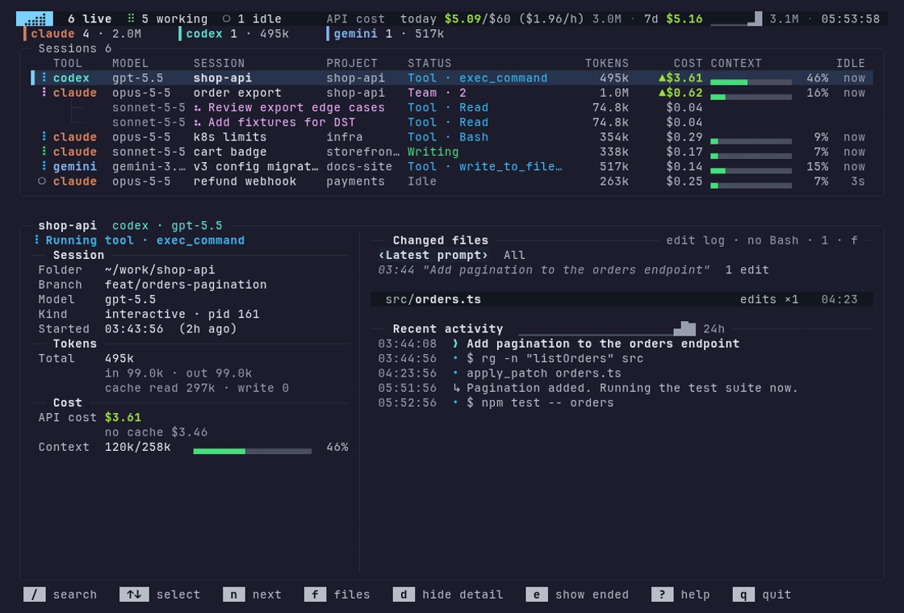

# ⣠⣴⣾ aitop

AI 코딩 에이전트를 위한 `top`. 내 PC 의 Claude Code · Codex CLI · Antigravity CLI 세션과 진행 내용, 토큰을 터미널 한 화면에서 실시간으로 보는 읽기 전용 모니터 (Gemini CLI 는 프로세스만). 훅을 넣지 않는다.

> `npx @sejuneoh/aitop`
>
> `npm i -g @sejuneoh/aitop`

- 첫 줄은 설치 없이 바로 실행한다.
- 둘째 줄로 설치한 뒤에는 `aitop` 만 치면 된다.



- **나를 기다리는 세션이 먼저 보인다.**
  - 기다리는 세션은 맨 위로 올라오고 `n` 으로 바로 간다.
  - `--notify=waiting,done,context` 로 데스크톱 알림을, `aitop --line` 으로 tmux 상태줄을 쓴다.
- **어느 세션이 무엇인지 안다.**
  - 모든 행에 세션 이름(`/rename` 이름이나 도구가 붙인 제목)이 보인다.
  - `y` 는 이어 열기 명령을 복사하고, `--report sessions` 는 어제 세션과 비용을 스탠드업용으로 정리한다.
- **훅 없음, 밖으로 보내는 것 없음.**
  - Claude Code · Codex CLI · Antigravity CLI 를 나란히, [여러 기록 폴더](#기록-폴더-여러-개)(`~/.claude`, `~/.claude-work` ...)에서 읽는다.
  - 각 도구가 이미 쓰는 기록만 읽고 설정은 건드리지 않는다. 네트워크·포트·외부 라이브러리 없음.

**목차**

- [빠른 시작](#빠른-시작) · [특징](#특징) · [화면](#화면) · [키](#키)
- [서브에이전트](#서브에이전트) · [기간 리포트](#기간-리포트) · [세션 리포트](#세션-리포트) · [호출 트리](#호출-트리)
- [알림](#알림) · [tmux 상태줄](#tmux-상태줄) · [기록 폴더 여러 개](#기록-폴더-여러-개) · [이어 열기](#이어-열기) · [JSON 출력](#json-출력) · [언어](#언어)
- [옵션 전체](#옵션-전체) · [설정 파일](#설정-파일) · [디버그 로그](#디버그-로그) · [색약 팔레트](#색약-팔레트) · [로고와 탭 아이콘](#로고와-탭-아이콘) · [폭이 모호한 기호](#폭이-모호한-기호)
- [읽는 곳](#읽는-곳) · [알려진 한계](#알려진-한계) · [비슷한 도구와 다른 점](#비슷한-도구와-다른-점) · [설치](#설치) · [릴리스](#릴리스)

## 빠른 시작

> `aitop`

- 실시간 화면.

> `aitop --all`

- 종료된 세션(24시간 이내)도 함께 보인다.

> `aitop --once`

- 현재 상태를 한 번 출력하고 끝난다.

> `aitop --json`

- 세션 목록과 오늘·7일 사용량을 JSON 으로 한 번 출력한다 (`--all` 과 함께 가능). [JSON 출력](#json-출력) 참고.

> `aitop --doctor`

- 도구별 연결 점검 (기록 폴더, 기록 수, 마지막 기록, 실행 수). `--json` 과 함께 가능.

> `aitop --line`

- tmux 상태줄용 한 줄 (예: `$54.13 wait 2 fix-login 3m run 3 $3.1/h`). [tmux 상태줄](#tmux-상태줄) 참고.

> `aitop --report sessions`

- 기간 안 세션별 비용. [세션 리포트](#세션-리포트) 참고.

> `aitop --help`

- 옵션 전체.

나머지 옵션은 [옵션 전체](#옵션-전체), 키는 [키](#키) 에 있다.

## 특징

- 포트를 열지 않고, 네트워크 요청을 하지 않는다. 각 CLI 가 내 PC 에 남기는 세션 파일만 읽는다.
- 세션 파일은 읽기 전용으로만 연다.
- 디스크에 쓰는 곳은 읽은 위치·합계를 기억하는 `~/.cache/aitop` 뿐이다 (지워도 된다). `--debug` 를 켰을 때만 디버그 로그를 따로 쓴다.
- 화면에 표시되는 텍스트 중 API 키·토큰처럼 보이는 값은 `••••` 로 가린다.
- 비용은 API 정가로 환산한 추정값이며 실제 청구액이 아니다.
- 외부 라이브러리 없음 (Node 22 이상).
- Antigravity CLI 의 세부 정보는 Node 22.15 이상에서만 읽는다. Node 내장 `node:sqlite` 로 기록을 immutable(파일을 하나도 만들거나 고치지 않는 열기)로 열 수 있어서다.

## 화면

실시간 화면에서 보이는 것을 위에서 아래 순서로 정리했다.

**헤더**

- 헤더 오른쪽: 오늘·최근 7일 Claude · Codex CLI · Antigravity CLI 사용량(토큰, API 환산 비용).
- 7일 막대: `7일 $644 ▅▁▃█▄▂▃` 는 오래된 날 → 오늘의 날짜별 비용이다.
- 지출 속도: `오늘 $194 ($31/h)` 의 괄호는 최근 1시간(5분 단위 근사) 비용이다.
- 하루 예산(`budgetDay`): 오늘 금액 옆에 `오늘 $12.30/$50` 처럼 보인다.
- 도구 줄: 헤더 아래 `▍claude 2 · 1.2M  codex  gemini`.

**세션 표**

- STATUS: 지금 단계 (`도구 실행 · Bash`, `생각 중`, `답변 작성 중`, `팀원 N명 작업 중`, `응답 대기`, `다음 지시 대기`). 큰 기록을 처음 읽는 동안은 `기록 읽는 중 N%`.
- `! 로그인 필요`·`! 연결 끊김`·`! API 오류로 멈춤`: 대기 중인 Claude 세션의 마지막 기록 줄이 API 오류(`isApiErrorMessage`)인 경우.
- `캐시 3:12`: 응답 대기·다음 지시 대기인 살아 있는 Claude 세션의 STATUS 글 뒤에 프롬프트 캐시 만료까지 남은 시간이 붙는다.
- `도구 실행 · Bash · 4m12s`: 작업 중 세션이 도구를 돌리는 동안 STATUS 글 뒤에 그 도구가 돈 시간이 붙는다.
- 응답 대기 세션은 맨 위에 배경색으로 보인다. 화면이 작아 표가 잘리면 마지막 줄에 `… +N 세션` 이 나온다.
- `● 완료 · 확인 전`: 작업 중이던 세션이 끝났는데 아직 선택해 보지 않은 세션. aitop 을 다시 켜면 초기화된다.
- 서브에이전트 행은 [서브에이전트](#서브에이전트) 참고.
- COST: Claude API 정가로 환산한 비용. 구독 요금제 사용분도 같은 기준으로 계산한다 (`src/pricing.mjs`). 아래 '비용 계산' 참고.
- IDLE: 마지막 활동 후 지난 시간. 작업 중이면 `now`.
- 색 없이도(NO_COLOR) 보이도록 비용 상위 두 세션에는 `▲`, 컨텍스트 85% 이상에는 `!` 가 붙는다.

**창 제목과 이동**

- 실시간 화면은 창(탭) 제목을 `󰚩 (2◆ 1! 1●) aitop` 처럼 아이콘과 응답 대기·멈춤·확인 전 수로 바꾼다.
- 헤더도 멈춘 세션을 `! 1 멈춤` 으로 따로 세고 `○ 지시 대기` 에서 뺀다.
- `n` 은 응답 대기 → 멈춤 → 확인 전 순서로 간다.
- `--bell` 을 주면 응답 대기가 새로 생길 때 벨을 한 번 울린다.

**상세 패널**

- 토큰 합계 = 메인 + 서브에이전트 = 입력 + 출력 + 캐시 읽기 + 캐시 쓰기. 비용은 캐시 제외 금액도 함께 보인다.
- 변경 파일: 세션(서브에이전트 포함)이 Edit/Write(Codex 는 apply_patch)로 고친 파일이 있으면 오른쪽 위에 `src/ui.mjs  편집 ×3  14:02` 처럼 편집 횟수와 마지막 시각이 보인다.
- 지시 탭: `[이번 지시] T5 T3 전체`. 처음에는 마지막 지시 뒤에 고친 파일만 보인다.

**`--all`**

- 24시간 안에 바뀐 기록을 종료 세션으로 보인다. 본문은 선택했을 때 읽는다.

<details>
<summary>세부: 헤더 사용량, 7일 막대, 지출 속도, 하루 예산</summary>

**헤더 사용량**

- 최근 7일 안에 바뀐 기록(서브에이전트 포함)을 날짜별로 모은다.
- agy 는 호출마다 그 직전 단계의 만든 시각을 호출 날짜로 본다.
- Codex 는 `token_count` 누적값이 직전보다 늘어난 만큼을 그 줄의 시각에, 그 앞의 마지막 모델 가격으로 더한다 (누적값이 줄면 새로 시작한 것으로 본다).
- 처음 실행 때는 `7일 집계 중 N%` 로 채워진다.
- 폭이 모자라면 토큰 수, 7일, 오늘 순으로 줄인다.

**7일 막대**

- 7일 중 가장 큰 날 기준(█)으로 그린다.
- 0 인 날은 흐린 `▁`, 쓴 날은 `▂` 이상이라 색이 없어도 갈린다.
- 집계 중에는 숨기고, 폭이 모자라면 지출 속도 다음으로 뺀다.
- `--json` 에는 `usage.last7days.daily: [{ date, cost }]` (API 환산)로 나간다.

**지출 속도**

- 0 이면 숨기고, 폭이 모자라면 가장 먼저 뺀다.
- `--json` 에는 `usage.lastHour` 로 나간다.

**하루 예산**

- 예상 비용 = 오늘 비용 + 최근 지출 속도 × 로컬 자정까지 남은 시간.
- 속도는 최근 1시간 중 자정 이후 몫만 시간당으로 늘린 값이다.
- 자정 뒤 15분이 안 됐거나 집계 중이면 예상 = 오늘 비용이다.
- 예상이 예산의 80% 이상이면 `· 예상 $45`, 100% 이상이면 경고 색과 `· 예상 $60!`.
- 예산은 비용 기준(`c`)과 상관없이 늘 API 환산으로 보며, 캐시 제외 화면에서는 `예산 $12.30/$50` 칸이 따로 붙는다.
- 폭이 모자라면 `/$50`, 오늘 금액 순으로 빼서 예상 경고를 시각 다음으로 오래 남긴다.
- 잘못된 `AITOP_BUDGET_DAY` 는 무시하고 `--doctor` 에 알린다.
- `--json` 에는 예산이 있을 때만 `usage.budget: { day, projected, unknown, level: ok·caution·warn }` 로 나간다 (화면과 같은 단계).

</details>

<details>
<summary>세부: 도구 줄, 상자, 키 안내 줄</summary>

**도구 줄**

- 조각 사이 간격은 2칸이다. 폭이 모자라면 토큰 수·`미설치`, 이름(`cla` `cdx` `gem`) 순으로 줄인다.
- 그래도 넘치면 세션이 없는 도구부터 빼고 끝에 `+N` 을 붙인다. 이름이 글자 중간에서 잘리지 않는다.
- 실행 중 세션이 없고 7일 동안 세션(기록 폴더의 가장 새 기록 포함)이 없는 도구는 숨긴다.
- 숨기면 줄 끝에 기록 폴더가 없는 도구와 오래 안 쓴 도구를 나눠 `미설치: codex  7일 미사용: gemini` 로 적는다 (자리가 모자라면 `미설치: 1  7일 미사용: 1`, 아주 좁으면 뺌).
- 숨기면 남는 도구가 하나도 없을 때는 숨기지 않고 예전처럼 흐리게 다 보인다 (`미설치` 포함).
- 끝의 `+N` 은 화면이 좁아 접은 도구 수다.
- 실행 중 세션이나 프로세스가 있으면 늘 보인다.
- 설정 파일 `"hideIdleTools": false` 로 끈다.
- 세션이 없는데 기록이 없는 도구의 프로세스가 실행 중이면, 빈 화면 첫 줄에 `agy 실행 중이지만 읽을 세션 기록이 아직 없습니다.` 와 다음 할 일(요청을 한 번 보내기, `aitop --doctor`)을 적는다.

**상자와 색**

- 화면 높이가 30줄 이상이면 세션 표를 `세션 N` 상자로 감싼다.
- 비용 색은 화면에서 가장 큰 금액 두 개에만 칠한다.

**키 안내 줄**

- 폭이 모자라면 오른쪽부터 줄이고 `?`·`q` 는 늘 남긴다.
- `NO_COLOR` 이면 키가 `[q]` 처럼 괄호로 보이고, 포커스된 상자는 굵은 선(`┏━┃`)으로 그린다.

</details>

<details>
<summary>세부: 멈춤, 캐시 남은 시간, 도구 경과 시간</summary>

**`! 로그인 필요` 등 멈춤**

- 훅·네트워크 없이 기록만 본다.
- 응답 대기·고정 바로 아래로 올라온다 (묶을 때는 제 묶음 맨 위).
- `done` 알림과 `● 완료 · 확인 전` 으로 치지 않는다.
- 그 뒤 정상 응답이나 사용자 입력이 기록되면 사라진다.
- 사용 한도(재개 시각)는 기록 표본이 없어 아직 따로 가르지 않는다.

**`캐시 3:12`**

- 마지막 요청이 캐시를 1시간으로 썼으면(`usage.cache_creation.ephemeral_1h_input_tokens`) 1시간, 5분으로 썼으면 5분, 읽기만 했으면 앞의 TTL 로 본다.
- 그 요청이 시작된 시각(바로 앞 기록 줄)부터 잰다 ([공식 문서](https://platform.claude.com/docs/en/build-with-claude/prompt-caching): 기본 5분, 캐시를 쓰거나 읽을 때마다 다시 시작).
- 기록으로 짐작한 값이다.
- 1분 미만이면 굵은 경고색, 지나면 흐린 `캐시 만료`.
- 폭이 모자라면 먼저 빠진다. 다만 1분 미만 경고(와 10분 넘은 도구 경과 시간)는 상태 글을 `지시 대기` 처럼 짧게 줄이고 남는다.
- 상세 패널에 한 줄 설명이, `--json` 에는 `cacheExpiresAt` (ISO, 없으면 `null`)이 나간다.
- Codex·Antigravity 는 해당 없음.

**`도구 실행 · Bash · 4m12s`**

- 결과가 아직 없는 호출의 시작 시각(Claude `tool_use`, Codex `function_call`, Antigravity 실행 중 단계)부터 잰다.
- 형식은 팀원 행 경과 시간과 같다.
- 1분이 지나야 보이고, 10분(Claude Code Bash 시간 제한 최대값)부터 흐린 경고색이다.
- 허락 대기 중에는 보이지 않고, 허락한 뒤에는 대기가 끝난 때부터 다시 잰다.
- 폭이 모자라면 먼저 빠진다.
- `--json` 에는 `toolStartedAt` (ISO, 없으면 `null`).

</details>

<details>
<summary>세부: 변경 파일과 지시 탭</summary>

**변경 파일**

- git diff 가 아니라 이 세션의 편집 기록이다.
- diff 머리의 `쓴 줄 · 지운 줄` 은 편집마다 더한 누적값이라 최종 변경량과 다르다.

**지시 탭**

- 편집이 있었던 이전 지시는 `T번호` 탭으로, 세션 전체는 `전체` 탭으로 본다.
- 서브에이전트 편집은 그 서브에이전트를 부른 지시에 들어간다.
- lock·빌드 결과 파일은 목록 끝에 흐리게 보인다.
- 지시는 최근 50개까지 기억한다.
- 파일을 열면 고친 순서의 역순으로 변경 조각마다 `시각 · 누가 · @@ 위치` 를 붙여 보인다.
- `.env`, `*.pem` 같은 비밀 파일은 목록에만 보이고 내용은 숨긴다.

</details>

<details>
<summary>세부: 비용 계산 (COST)</summary>

**Claude**

- 값은 Anthropic 공식 가격표(https://platform.claude.com/docs/en/about-claude/pricing, 2026-11-18 확인) 기준이다.
- Haiku 5.5 의 10만 토큰 초과 요청 단가는 반영하지 않고 기본 단가로 계산한다.
- 모델 이름이 표와 똑같을 때만 가격을 매긴다.
- 끝의 날짜(`-20250514`, Vertex 의 `@20250514`)와 `-latest`, Bedrock 의 앞 `anthropic.`·`global.anthropic.` 등과 끝 `-v1:0`, Claude Code 의 `[1m]` 은 떼고 본다.
- 공식 별칭 `claude-opus-4-0`·`claude-sonnet-4-0` 은 `claude-opus-4`·`claude-sonnet-4` 로 본다.
- 이 찾는 규칙은 v0.34.0 까지의 앞부분 일치에서 바뀐 것이다. 그래서 업그레이드 뒤 첫 실행 때 캐시와 월별 보관함의 비용을 다시 계산한다.
- claude-opus-4-9 처럼 앞부분만 같은 모델을 포함해 가격표에 없는 모델은 추측하지 않고 비용에서 뺀다 (`--json` 은 `unpriced` 로 알린다).
- 컨텍스트 창 크기는 돈이 아니어서, 표와 똑같은 이름이 없으면 앞부분이 같은 계열의 값(claude-sonnet-5-6 이면 claude-sonnet-5)을 쓴다.
- 그것도 없으면 사용량으로 추측한다 (200K 를 넘었으면 1M).

**Codex**

- OpenAI API 정가로 환산한다 (gpt-5.6-sol/terra/luna, gpt-5.5, gpt-5.4(-mini), gpt-5.3-codex, gpt-5.2, gpt-5.1-codex(-max, -mini), gpt-5(-mini, -codex), codex-mini, gpt-4o-mini).
- 값은 OpenAI 공식 가격표(https://developers.openai.com/api/docs/pricing)와 모델별 문서(2026-11-18 확인) 기준이다.
- 세션 중 모델이 바뀌면 마지막 모델 가격으로 계산한다.
- 모델 이름이 표와 똑같을 때(끝의 `-latest` 나 날짜는 떼고 본다)만 가격을 매기고, gpt-5.5-pro 처럼 앞부분만 같은 모델은 비용에서 빠진다.
- 입력 272K 초과 요청의 긴 컨텍스트 단가(입력 2배·출력 1.5배)는 반영하지 않고 기본 단가로 계산한다.
- gpt-5.6-sol 은 2026-11-30 까지의 프로모션 가격이다 (그 뒤 가격은 아직 공개되지 않았다).

**Antigravity CLI**

- Google 공식 Gemini API 가격표(유료 등급 standard, https://aistudio.google.com/docs/pricing, 2026-11-18 확인)로 호출마다 그 호출 시각의 가격으로 환산한다.
- gemini-4-argon 은 2026-12-01 부터, gemini-3.8-flash·gemini-3.6-flash 는 2027-01-01 부터 두 배 가격이다 (UTC 기준).
- gemini-4-hydrogen, gemini-3.5-flash-lite, gemini-3.1-flash-lite 도 표에 있다.
- 모델 이름이 표와 똑같을 때만 가격을 매기고, 그 밖의 모델(gemini-3.5-flash, gemini-3-flash-preview 등)은 추측하지 않고 비용에서 뺀다.

**공통**

- 서브에이전트 비용은 부모 세션에 더한다.

</details>

## 키

| 키 | 동작 |
|---|---|
| / | 세션 검색 (이름·폴더·모델). Enter 적용, Esc 지우기 |
| ↑↓ / j k | 세션 선택 |
| n | 다음 볼 세션으로 이동 (응답 대기 → 완료 · 확인 전) |
| p | 고른 세션을 표 맨 위(응답 대기 바로 아래)에 고정, 다시 누르면 해제 (아래 세부) |
| f / Tab | 변경 파일 목록으로. ←→ 지시 탭, ↑↓ 파일 고르기, Enter diff 보기 |
| diff 에서 ↑↓ · space · [ ] | 스크롤 · 페이지 · 이전·다음 파일 |
| d | 상세 열기·닫기 |
| y | 고른 세션을 이어 여는 명령을 클립보드로 복사 (OSC 52). [이어 열기](#이어-열기) 참고 |
| e | 종료된 세션 보이기·숨기기 |
| c | 비용 기준 전환: API 환산(캐시 포함, 기본) ↔ 캐시 제외(입력·출력만). 표·헤더·상세가 같이 바뀐다 |
| ? | 도움말 (아래 세부) |
| Esc | 한 단계 뒤로 (도움말 닫기, 검색 지우기, diff → 파일 목록 → 세션). 종료하지 않는다 |
| q / Ctrl-C | 나가기 |

<details>
<summary>세부: 고정(p), 도움말(?)</summary>

**`p` 고정**

- 여러 개는 고정한 순서로 두고 정렬(`s`)이 바꾸지 않는다.
- 묶기(`g`)에서는 `고정` 묶음으로 모인다.
- 고정한 행은 SESSION 칸 앞에 `★` (좁은 화면에서도 이름보다 먼저 남는다).
- 종료 세션을 함께 볼 때(`e`) 고정한 종료 세션도 실행 중인 세션보다 위에 남는다.
- 이번 실행에만 기억한다.

**`?` 도움말**

- 키 안내 줄의 `?` 이름은 폭과 상관없이 `도움` 하나다.
- 지금 화면(세션 표·검색어가 걸린 표·상세·파일 목록·diff)의 키부터, 다른 화면 · 옵션 · 지금 설정 값 순으로 보인다.
- 열려 있는 동안은 ↑↓ j k space PgUp PgDn 스크롤, ? · Esc 닫기, q 나가기만 듣는다.

</details>

## 서브에이전트

서브에이전트는 메인 세션 아래 `├─` 행으로 붙는다.

> `aitop`

- 하는 일(description) 뒤에 타입이 흐리게 붙는다.
- 첫 응답 전에는 `시작 중`, 끝나면 6초간 `완료`로 보였다가 사라진다.
- 작업 중인 서브에이전트 행에는 시작한 뒤 지난 시간이 `◷` 를 앞에 붙여 보인다 (`◷42s`, `◷3m12s`, `◷1h05m`). 세션 행 IDLE(마지막 활동 후)과 같은 자리라 기호로 가르고, `AITOP_AMBIGUOUS=wide` 에서는 `~3m12s` 다.
- 작업 중인 서브에이전트의 기록이 3분 동안 바뀌지 않으면 흐린 `멈춘 듯` 이 붙는다. 짐작일 뿐이다.
- Antigravity 서브에이전트가 허락을 기다리면 부모 행도 `<에이전트>: <도구>` 로 응답 대기가 된다.
- Claude 세션이 띄운 `claude -p` 실행(프로세스 부모, 끝난 뒤에는 작업 폴더 `~/.claude/jobs/<id>/`로 찾는다)은 그 세션 아래 `-p` 행으로 붙고 비용은 부모에 더한다. 부모가 없는 실행(cron 등)은 최상위에 `자동` 표시로 남고 응답 대기 알림에서 빠진다.
- 부모 세션이 24시간 넘게 살아 있으면 그보다 오래 전에 끝난 `claude -p` 실행은 부모 합계에서 빠진다.

<details>
<summary>세부: <code>멈춘 듯</code>, Antigravity 대기</summary>

**`멈춘 듯`**

- 오래 걸릴 수 있는 도구(Bash, PowerShell, 서브에이전트 안의 에이전트, 웹 가져오기·검색, MCP 도구, agy `run_command`)가 도는 중이면 10분을 기다린다.
- 세션이 응답 대기 중이면 붙지 않는다.
- 정렬·알림·창 제목·`--line` 에는 쓰지 않는다.
- 화면이 좁으면 경과 시간 뒤의 `?` 하나로 줄어든다.
- `--json` 에는 팀원마다 `stalled`, `startedAt`, `lastActivityAt` 으로 나간다.

**Antigravity 대기**

- 그래서 맨 위로 올라오고 `n`·`--notify`·`--line` 에도 잡힌다.
- 부모 자신이 기다리면 부모 것이 먼저 보인다.
- 다른 서브에이전트의 대기는 각자의 행에 보인다.

</details>

## 기간 리포트

최근 N일(또는 N달)의 날짜별 토큰과 비용을 표로 내고 끝난다 (실시간 화면 없음).

> `aitop --report daily`
>
> `aitop --report daily --by model --days 14`
>
> `aitop --report monthly --by model --months 6`

- 전체 형식: `aitop --report daily [--by tool|model|project] [--days N] [--json]`.
- 달별: `aitop --report monthly [--by tool|model|project] [--months N] [--json]`. 최근 N달(최대 12)의 달별 표다.
- `--by tool` (기본) 은 도구(claude · codex · agy)별 열, `--by model` 은 모델별 열, `--by project` 는 프로젝트별 열이다.
- `--days N` 은 기본·최대 30일이다. 30을 넘기면 30일로 줄이고 stderr 에 알린다.
- `--months N` 은 기본·최대 12다. 최근 달이 위다.
- 줄은 최근 날짜가 위(오늘부터 거꾸로)이고 맨 아래가 합계다. 비용은 헤더와 같은 API 정가 환산이다.
- `--json` 은 같은 값을 영어 키와 숫자로만 낸다.

```
$ aitop --report daily --days 3 --lang en
Daily usage, last 3 days (2026-11-09 to 2026-11-11), by tool, API list price

Date            claude          agy       Total
----------  ----------  -----------  ----------
2026-11-11   394M $175  21.4M $3.62   415M $179
2026-11-10   832M $326            -   832M $326
2026-11-09   461M $176   4.8M $0.83   466M $177
----------  ----------  -----------  ----------
Total       1.69B $677  26.1M $4.45  1.71B $681
```

<details>
<summary>세부: 열, 프로젝트, 가격 없는 모델, <code>--json</code></summary>

**열**

- 열은 기간 비용이 큰 순서이고, 기간에 쓰지 않은 열은 뺀다.
- 합계는 위 날짜 줄을 더한 값이다.

**프로젝트**

- 프로젝트는 기록 파일마다 정한다.
- Claude 는 기록의 `cwd` (없으면 `projects/` 아래 폴더 이름).
- Codex 는 `turn_context.cwd`.
- agy 는 대화의 작업 폴더(`workspace_uris`, 서브에이전트는 부모 대화).
- Claude Code 작업 트리(`<저장소>/.claude/worktrees/<이름>`)는 저장소 하나로 합친다.
- 못 찾으면 `(모름)` 열이다.
- 이름은 작업 폴더의 마지막 이름이고, 겹치면 앞 폴더를 붙인다 (`dev/aitop`).
- 열이 터미널 폭을 넘으면 비용이 작은 쪽을 `(그 외)` 로 합친다.
- `--json` 은 다 내고, 이름별 경로를 `paths` 에 둔다.

**가격 없는 모델**

- 가격표에 없는 모델은 추측하지 않고 비용에서 뺀다 (전부 그런 칸은 `-`).
- `--json` 은 그 칸의 `unpriced` 가 `true` 다.

**`--json` 키**

- `report`, `by`, `days`, `from`, `to`, `basis`, `partial`, `unpriced`, `columns`, `paths` (`--by project` 때만).
- `rows[]{date, tokens, cost, unpriced, items}`, `total{tokens, cost, unpriced, items}`.
- `items` 의 칸도 `{tokens, cost, unpriced}` 다.

</details>

<details>
<summary>세부: 장부 캐시와 첫 실행</summary>

- 장부는 날짜별·모델별 합계를 기록마다 캐시에 남긴다 (캐시 형식 14, 장부 kind 2).
- 평소 실행(화면 · `--json` · `--line`)은 지금처럼 최근 7일 안에 바뀐 기록만 읽는다.
- `--report` 만 30일 안에 바뀐 기록까지 읽는다. 그래서 처음 `--report` 는 30일치 기록을 읽느라 수십 초 걸릴 수 있다.
- stderr 가 터미널이면 진행률을 보인다.
- 120초(`AITOP_REPORT_MS`)를 넘으면 읽은 만큼으로 표를 내며 덜 읽었다고 알린다 (`--json` 은 `partial: true`).
- 읽은 만큼은 캐시에 남아 다음 실행이 이어 읽는다.

</details>

<details>
<summary>세부: 달별 보관함 (<code>monthly.json</code>)</summary>

- 지난 날은 이틀쯤 뒤에 캐시 폴더의 `monthly.json` (버전 폴더 밖) 에 달별로 접어 12개월 남긴다.
- 그래서 캐시를 다시 세거나(형식·가격표 변경) Claude Code 가 오래된 기록을 지워도 달별 합계는 남는다.
- 접기는 평소 화면·`--once`·`--line`·`--report` 가 기록을 다 읽었을 때 하루 한 번 한다.
- 한 날은 한 번만 센다: 보관함은 접은 마지막 날(`through`)까지, 그 뒤 날은 장부에서 센다.
- agy 기록을 읽지 못하면 그 기록이 쓰였을 수 있는 날 전날까지만 접는다. 7일 넘게 밀리면 그 기록을 빼고 접어 그 날들의 달을 `~` 로 둔다.
- 처음 실행은 12개월 전 달 1일부터 남은 기록을 한 번 다 읽어 보관함을 채운다.
- 진행률·120초 상한은 daily 와 같고, 상한에 걸리면 접지 않고 다음 실행이 이어 읽는다.
- `*` 는 이번 달이다.
- `~` 는 일부 날만 센 달이다 (남은 Claude 기록 중 가장 오래된 날보다 앞 등).
- `기록 없음` 은 기록도 보관함도 없는 달이다 (0 이 아니라 모름).
- 보관함은 모델별 토큰을 종류별(입력·출력·캐시 읽기·캐시 쓰기)로 남겨, 가격표가 바뀌면 지금 가격으로 다시 계산한다.
- `--by project` 도 보관한 달까지 나눈다.
- `--json` 의 줄은 `month`, `current`, `status` (`complete` · `partial` · `missing`) 를 둔다.
- 깨진 `monthly.json` 은 `monthly.json.bad-<시각>` 으로 옮기고 새로 시작한다.
- 기록 폴더가 여럿일 때의 '일부' 경계는 [기록 폴더 여러 개](#기록-폴더-여러-개) 참고.

</details>

## 세션 리포트

기간 안에 사용량이 있는 세션을 비용이 큰 순서로 한 줄씩 보인다. 스탠드업이나 공유용이다.

> `aitop --report sessions`
>
> `aitop --report sessions --md --plan 200`
>
> `aitop --report sessions --since 7d --json`

- 전체 형식: `aitop --report sessions [--since yesterday|today|Nd|YYYY-MM-DD] [--plan USD] [--md|--json] [--show-prompts]`.
- 기간 기본: 어제 0시부터 지금까지, 최대 30일 전.
- `--plan 200` 처럼 월 구독료를 주면 기간 몫(경과 일수/30)의 몇 배인지 보인다.
- `--md` 는 그대로 붙여 넣을 Markdown 이다 (칸 안의 `|` 와 줄바꿈은 이스케이프).
- `--json` 은 `summary` 와 `sessions[]` 를 숫자로 낸다.
- 첫 지시는 `--show-prompts` 일 때만 보인다 (한 줄, 약 60자). 기본 출력과 `--json` 에는 지시 글이 없다.
- 맨 위 요약 카드: 기간 합계, 도구별 비중, 세션 수. 모두 API 정가 환산이며 실제 청구액이 아니다.
- 요약 카드 마지막 줄은 기간 안 기다림 합계다 (`에이전트가 기다린 시간 1h12m (추정)`).

<details>
<summary>세부: 칸</summary>

- 도구.
- 주된 모델 (여럿이면 `+N`).
- 프로젝트 (`--by project` 와 같은 규칙).
- 세션 이름 (사용자 이름 > 도구가 붙인 제목 > 폴더).
- 기간 안 활동의 시작·끝.
- 기다림 (아래).
- 토큰.
- 비용 (API 정가 환산, 가격표에 없는 모델은 빼고 셈).
- 고친 파일 수 (모르면 `-`, agy 는 늘 `-`).
- Claude 서브에이전트는 부모 세션에 더한다.

</details>

<details>
<summary>세부: 기다림(나를 기다린 시간)은 어떻게 추정하나</summary>

- 기다림은 **추정**이다. 에이전트 쪽 마지막 줄(응답, 도구 결과) 시각부터 내 다음 입력 시각까지의 간격을 더한다.
- 입력은 Claude 는 내가 친 지시(슬래시 명령 포함)와 허락 창·질문(AskUserQuestion)에 내가 고른 답이다.
- Codex 는 `user_message` 다.
- 일하는 중에 미리 넣은 지시, 백그라운드 작업 알림은 세지 않는다.
- 내가 끊은 때부터는 다시 센다.
- 기록에는 화면 앞에 있었는지가 없어 **자리를 비운 시간과 구분하지 못한다**.
- 그래서 간격 하나는 앞 2시간까지만 센다 (밤새 열어 둔 세션이 합계를 덮지 않게).
- Claude 허락은 창이 뜬 시각이 기록에 없어 도구 호출부터 결과까지를 센다. 그래서 허락 뒤 도구가 돈 시간도 섞인다.
- Codex 는 허락을 기록에 남기지 않아 지시만 센다.
- 날짜 경계에 걸친 간격은 기간 안 몫만 센다.
- 서브에이전트는 세지 않고 부모 세션 기준으로만 센다.
- 세션마다 따로 더하므로 여러 세션을 함께 돌리면 합계가 실제 경과 시간보다 길 수 있다.
- agy 는 `-` 다.
- `--json` 은 `waitedMs`(밀리초, 모르면 `null`)를 세션과 `summary` 에 둔다.

</details>

<details>
<summary>세부: 시작·끝과 고친 파일을 읽는 방법</summary>

- 시작·끝과 고친 파일은 장부와 따로 기록을 읽어 얻는다 (캐시 kind `sheet2`, 기다림을 더하며 `sheet1` 에서 올렸다).
- 그래서 처음 실행은 기간 안 기록을 한 번 더 읽는다.
- agy 시작·끝은 장부의 호출 시각이라, 이 버전 전에 이미 센 날은 `-` 로 보일 수 있다.

</details>

## 호출 트리

Claude Code 세션 하나를 지시 → 도구 호출 → 서브에이전트(그 `Agent`·`Task` 호출 아래) 트리로 보인다. 줄마다 걸린 시간·토큰·추정 비용(API 정가 환산)을 붙인다.

> `aitop --report trace fix-login`
>
> `aitop --report trace 1a2b3c4d --json`

- 전체 형식: `aitop --report trace <세션> [--md|--json] [--show-prompts]`.
- 세션은 id 앞부분(`--json`·이어 열기 명령의 id), 기록 파일 경로, 또는 `/rename` 이름·제목으로 준다. 여럿이 맞으면 후보를 보이고 끝난다.
- 명령·경로 같은 인자와 지시 글은 `--show-prompts` 일 때만 보이고, 그때도 비밀값은 가린다.
- 기록을 한 번 읽을 뿐 아무것도 쓰지 않는다.
- Codex·Antigravity 세션은 아직 지원하지 않는다.

<details>
<summary>세부: 비용 나누기, 접기, 표시</summary>

- 도구 줄 비용은 그 도구를 부른 응답의 비용을 그 응답이 부른 도구 수로 나눈 몫이다.
- 서브에이전트 줄과 지시 줄은 그 가지 전체 합이다.
- 아주 오래된 기록의 서브에이전트 줄은 트리에 넣지 못해 다른 리포트의 세션 비용과 조금 다를 수 있다.
- 같은 도구 연속 호출은 `Grep ×38` 처럼 묶는다.
- 서브에이전트 안 단계보다 깊은 가지는 접어 수만 보인다.
- 300줄을 넘으면 오래된 지시부터, 그다음 지시·서브에이전트 안의 앞쪽 단계부터 빼고 `앞 N개 생략` 으로 알린다.
- 실패한 호출은 `✗`, 아직 결과가 없는 호출은 `●` 이다.
- 다음 지시가 먼저 왔거나 기록이 15분 넘게 바뀌지 않았는데 결과가 없는 호출은 `(결과 없음)` 이다.

</details>

## 알림

다른 창에서 일할 때 켠다. 둘 다 기본으로 꺼져 있고, 실시간 화면에서만 동작한다.

> `aitop --notify`
>
> `aitop --notify=waiting,done,context`
>
> `aitop --on-waiting 'my-hook.sh'`

- `--notify`: 데스크톱 알림. Linux 는 notify-send, WSL·Windows 는 Windows 알림, macOS 는 osascript. 없으면 조용히 건너뛴다 (`--doctor` 에 보임).
- `--notify=waiting,done,context`: 알릴 종류를 고른다. `--notify` 만 주면 설정 파일 `notify` 배열의 종류, 없으면 `waiting` 만.
- `--on-waiting`: 응답 대기가 새로 생길 때마다 `/bin/sh -c` (Windows 는 `cmd.exe /d /v:on /s /c`) 로 명령 실행 (`--on-waiting=<명령>` 도 됨).
- `--bell` 처럼 aitop 을 켰을 때 이미 응답 대기인 세션은 알리지 않는다.

**종류**

| 종류 | 언제 |
|---|---|
| `waiting` (기본) | 세션이 새로 응답(허락) 대기가 될 때 |
| `done` | 한 작업에서 작업 중이던 시간의 합(응답 대기 시간은 뺀다)이 3분(설정 파일 `doneMinutes`) 이상인 세션이 다음 지시 대기가 되고, 그 대기가 5초 이어질 때 한 번 |
| `context` | 컨텍스트 사용률이 90% 를 넘을 때 한 번. 85% 아래로 내려가면(압축 등) 다시 알린다 |

<details>
<summary>세부: 알리지 않는 경우, 종류 고르는 순서</summary>

**`done` 을 알리지 않는 경우**

- 도구 호출 사이의 잠깐 대기, 응답 대기, 끝난 세션, 하위 에이전트.
- API 오류로 멈춘 세션, 상태를 기록 시각으로 추측한 세션.

**`context` 를 알리지 않는 경우**

- aitop 을 켰을 때나 새 세션의 기록을 처음 다 읽었을 때 이미 넘어 있으면 알리지 않는다.

**종류 고르는 순서**

- 종류는 데스크톱 알림과 `--on-waiting` 명령에 함께 쓴다.
- 이름은 예전 그대로 `--on-waiting` 이고, 어떤 일인지는 `AITOP_EVENT` 로 가른다 (예: `[ "$AITOP_EVENT" = done ] && say 끝`).
- 종류는 명령줄 `--notify=<종류>` > 설정 파일 `notify` 배열 > `waiting` 순서로 정한다.
- 그래서 종류를 따로 정하지 않으면 예전처럼 응답 대기에만 실행된다.
- `--no-notify` 는 데스크톱 알림만 끄고, `--on-waiting` 명령은 그 종류를 그대로 따른다.
- 벨(`--bell`)은 늘 응답 대기만 울린다.

</details>

<details>
<summary>세부: WSL, D-Bus, 알림 본문</summary>

- WSL 과 Windows 에서는 `powershell.exe` 로 Windows 알림을 띄운다 (Windows PowerShell 이름으로 뜨고 따로 설정할 것은 없다). Windows 는 `%SystemRoot%` 아래 것을 먼저, 없으면 PATH 에서 찾는다.
- PATH 에 `powershell.exe` 가 없으면 notify-send 를 쓴다.
- notify-send 는 D-Bus 세션 버스가 있어야 뜬다.
- `DBUS_SESSION_BUS_ADDRESS` 가 없거나 그 소켓 파일이 없으면 알림이 뜨지 않으므로 `--doctor` 가 알림 줄에 `!` 와 안내를 보인다.
- 도구가 없거나 알림이 실패하면 조용히 건너뛴다.
- 알림 본문에는 세션에 붙인 이름(Claude Code `/rename` 이나 다른 세션이 붙인 이름, Codex `thread_name`)이 있으면 그 이름이, 없으면 프로젝트 이름이 들어간다.
- 데스크톱 알림은 잠금 화면에도 보일 수 있으니 이름도 그대로 보인다.

</details>

<details>
<summary>세부: <code>--on-waiting</code> 명령의 환경변수와 실행 규칙</summary>

**권한과 전달**

- `--on-waiting` 명령은 **aitop 을 실행한 사용자 권한 그대로** 돈다.
- 세션 정보는 명령 문자열에 끼워 넣지 않고 환경변수로만 넘긴다 (명령 안에서 쓸 때는 `"$AITOP_PROJECT"` 처럼 따옴표로 감싼다).

| 환경변수 | 값 |
|---|---|
| `AITOP_EVENT` | `waiting` · `done` · `context` |
| `AITOP_TOOL` | claude · codex · agy 등 |
| `AITOP_PROJECT` | 프로젝트 이름 |
| `AITOP_SESSION_ID` | 세션 id |
| `AITOP_CWD` | 작업 폴더 |
| `AITOP_WAITING_FOR` | 짧은 대기 사유 (예: `Bash`, 비밀값처럼 보이는 것은 가림) |

**실행 규칙**

- 출력은 버리고, 10초가 지나면 명령(과 그 자식)을 끝낸다.
- 한 번에 하나만 실행한다.
- 실행 중에 새 대기가 생기면 가장 최근 것 하나만 기다렸다가 이어서 실행한다 (그 사이 것은 건너뜀).
- 그래서 여러 세션이 한꺼번에 응답 대기가 되면, 지금 명령이 끝난 뒤 그중 가장 최근 하나만 실행된다.
- 한 번 갱신에서 여러 세션이 함께 응답 대기가 되면 첫 세션과 마지막 세션만 실행되고 그 사이 세션은 건너뛴다.
- aitop 을 끝내면 실행 중인 명령도 함께 끝낸다.
- 명령이 자식을 백그라운드로 띄우고(`cmd &`) 먼저 끝나면, 그 자식은 10초 제한과 종료 정리 밖에 남으므로 정리는 명령이 맡는다.
- Windows 는 `%COMSPEC%`(보통 `cmd.exe`) `/d /v:on /s /c` 로 창 없이 실행하고, 끝낼 때는 `taskkill /T /F` 로 자식까지 끝낸다.
- Windows 명령 안에서는 값을 `%AITOP_PROJECT%` 가 아니라 `!AITOP_PROJECT!` 로 읽는다. cmd 는 `%…%` 값 안의 `&`·`|`·`>` 를 명령으로 읽지만 `!…!` 값은 글자 그대로 둔다. 대신 명령 글 안의 `!` 는 변수 표시로 읽힌다.
- 훅이 부르는 `.bat`·`.cmd` 파일 안에서도 `%AITOP_PROJECT%` 는 값이 스크립트로 읽힌다. 배치 첫 줄에 `setlocal enabledelayedexpansion` 을 두고 `!AITOP_PROJECT!` 로 읽거나, 훅을 PowerShell 로 쓰고 `$env:AITOP_PROJECT` 로 읽는다.

</details>

## tmux 상태줄

`aitop --line` 은 한 줄을 내고 끝난다.

> `aitop --line`
>
> `aitop --line=tmux`

```tmux
set -g status-right '#(aitop --line=tmux)'
set -g status-interval 15
```

**항목** (이 순서, 0 인 항목은 뺀다)

- 오늘 비용 (헤더와 같은 API 환산, 하루 예산이 있으면 `/$50`).
- 응답 대기: 가장 오래 기다린 세션 이름과 대기 시간. 하나면 `wait fix-login 3m`, 둘 이상이면 `wait 2 fix-login 3m`.
- 오류로 멈춘 Claude Code 세션 수 (`stop 1`, 기록 끝에서 바로 센다).
- 작업 중 세션 수 (`run 3`).
- 최근 1시간 지출 (`$3.1/h`).

**옵션**

- `--line=tmux`: 항목마다 `#[fg=colourN]...#[default]` 를 씌운다. 기본은 색 없는 글.
- `--line-width N` (기본 40): 넘으면 뒤 항목부터 뺀다.
- 세션 이름이 들어가므로 tmux 에는 반드시 `--line=tmux` 를 쓴다.

<details>
<summary>세부: 폭, 이름, 글자, 색</summary>

**폭**

- 대기 항목은 `stop` 다음에 이름과 시간을 빼고 수(`wait 2`)를 남긴다.
- 하루 예산과 대기 이름이 함께 있으면 기본 폭 40 에서 `$/h` 가 빠지기 쉽다. 보고 싶으면 `--line-width` 를 늘린다.

**이름**

- 세션 이름은 화면 SESSION 칸과 같은 이름을 12칸으로 자른다 (자른 자리는 `~`).
- Claude Code 세션이 자동 이름이면 작업 폴더 이름을 쓴다.

**글자**

- 글자는 ASCII 만 쓴다 (이모지·폭이 모호한 기호는 tmux 에서 칸이 어긋난다).
- 세션 이름의 한글·한자·가나만 남기고 제어 문자·이모지 등은 지운다.
- 표기는 짧은 영어 약어로 고정하고 번역하지 않는다.

**색**

- `--line=tmux` 의 색: 대기는 주황, 멈춤은 빨강, 돈은 연두, `--color-blind` 면 노랑·주홍·파랑.
- ANSI 코드는 넣지 않는다.
- `NO_COLOR` 가 있으면 tmux 서식도 넣지 않는다.

</details>

<details>
<summary>세부: 이스케이프 (tmux, zsh)</summary>

- `--line=tmux` 모드는 이름 속 `#` 을 `##` 로 바꾼다.
- 일반 출력을 그대로 넣으면 이름 속 `#{...}`·`#(...)` 를 tmux 가 해석할 수 있다.
- zsh 프롬프트(`PROMPT_SUBST`)에 넣으면 이름 속 `%` 를 zsh 가 해석할 수 있다.
- `%` 를 `%%` 로 바꿔 넣거나(예: `${$(aitop --line)//\%/%%}`) tmux 에서만 쓴다.

</details>

<details>
<summary>세부: 무엇을 읽나 (캐시, 세션 파일, 요약)</summary>

- 장부 캐시와 그 뒤에 붙은 줄만 읽고 세션 화면용 기록 전체·프로세스 목록은 읽지 않는다.
- 캐시가 없어(처음 실행) 1.5초 안에 다 읽지 못하면 `...` 을 내고 0 으로 끝난다.
- 읽은 만큼은 aitop 캐시에 남아 다음 실행이 이어 읽는다.
- 응답 대기 수 중 Claude Code 몫은 세션 파일(`~/.claude/sessions` 와 pid)로 매번 지금 값을 센다.
- 대기 시간도 세션 파일의 상태 시각으로 센다.
- 작업 중 수와 Antigravity 의 대기 수·이름(오래 기다린 순서로 둘)은 실시간 화면·`--once`·`--json` 이 캐시에 남기는 작은 요약(`summary.json`)에서 읽는다.
- 화면은 수가 바뀌면 5초 안에, 그대로여도 20초마다 다시 쓴다.
- 60초보다 오래된 요약은 쓰지 않고 `run` 과 Antigravity 대기 수·이름을 뺀다 (틀린 수를 보이지 않게).

</details>

## 기록 폴더 여러 개

Claude Code 프로필을 여럿 쓰면(`CLAUDE_CONFIG_DIR=~/.claude-work claude` 처럼) 기록 폴더도 여럿이다. 목록을 주면 모두 읽는다.

> `AITOP_CLAUDE_DIRS=~/.claude:~/.claude-work aitop`
>
> `aitop --print-config`
>
> `aitop --doctor`

- 설정 파일: `"claudeDirs": ["~/.claude", "~/.claude-work"]`, `"codexHomes": ["~/.codex", "~/.codex-alt"]`.
- 또는 aitop 전용 환경 변수 `AITOP_CLAUDE_DIRS`·`AITOP_CODEX_HOMES` 에 경로를 `:` 로 이어 준다 (Windows 는 `;`).
- 순서는 `AITOP_*` > 설정 파일 > 물려받은 `CLAUDE_CONFIG_DIR`·`CODEX_HOME` > 기본값이다.
- 기본값은 예전처럼 `~/.claude`, `~/.codex` 하나다.
- 실제로 쓰는 출처는 `aitop --print-config` 에 `env (AITOP_CLAUDE_DIRS)` 처럼 보인다.
- `aitop --doctor` 는 읽는 폴더 전부와, 기록이 있는데 읽지 않는 폴더를 넣는 방법과 함께 보인다.

<details>
<summary>세부: 우선순위, 경로 나누기, 중복</summary>

- Claude Code·Codex 용으로 export 해 둔 `CLAUDE_CONFIG_DIR` 가 설정 파일 목록을 가리지 않는다.
- 설정 파일 목록이 없을 때만 그 경로를 읽는다.
- 값 전체가 있는 폴더면 나누지 않으므로, 예전에 `:` 가 든 경로 하나를 준 경우도 그대로 동작한다.
- 실제 경로(링크 포함)가 같은 폴더는 한 번만 읽는다.
- 같은 세션 기록(같은 `projects/<폴더>/<id>.jsonl`, 같은 rollout 파일 이름)이 두 폴더에 복사돼 있으면 더 최근에 바뀐 하나만 센다.
- 실행 중 세션도 세션 id 로 하나로 합친다.

</details>

<details>
<summary>세부: 장부 캐시와 월별 리포트</summary>

- 장부 캐시는 파일 전체 경로로 따로 둔다.
- 월별 리포트의 '일부' 경계는 폴더마다 가장 오래된 기록 중 가장 늦은 날이다.
- Claude Code 는 폴더마다 따로 지운다. 그래서 옛 기록이 남은 폴더 하나 때문에 다른 폴더에서 이미 지워진 날을 '빠짐없음' 으로 접지 않게 안전한 쪽을 고른다.

</details>

<details>
<summary>세부: 비슷한 이름의 폴더와 <code>--doctor</code></summary>

- 비슷한 이름의 폴더를 저절로 읽지는 않는다. 다른 계정·백업을 모르게 섞으면 비용이 두 번 잡히거나 남의 기록이 보일 수 있어서다.
- 대신 `aitop --doctor` 가 다음 중 기록이 있는데 읽지 않는 폴더를 넣는 방법과 함께 보인다.
  - 설정 파일 목록 때문에 쓰지 않게 된 `CLAUDE_CONFIG_DIR`·`CODEX_HOME`.
  - 홈 바로 아래 `~/.claude`·`~/.claude-*`·`~/.claude.*`·`~/.claude_*`·`~/.config/claude`(`projects/` 가 있는 것).
  - `~/.codex`·`~/.codex-*` 등(`sessions/` 가 있는 것).
- 내 소유가 아닌 폴더는 후보로도 보지 않는다.
- `--doctor --json` 의 `tools.claude`·`tools.codex` 에는 `dirs`(읽는 폴더마다 `path`·`found`·`records`)와 `candidates`(`path`·`records`)가 붙는다.
- `path` 는 예전처럼 첫 폴더다.

</details>

## 이어 열기

다른 곳에서 세션을 이어 연다. `y` 는 고른 세션을 이어 여는 명령을 클립보드로 복사한다 (OSC 52). 상세 패널의 `이어 열기` 에 같은 명령이 보인다.

> Claude: `cd <폴더> && claude --resume <id>`
>
> Codex: `cd <폴더> && codex resume <id>`
>
> Antigravity: `cd <폴더> && agy --conversation <id>`

- Gemini CLI 는 없음.
- `--json` 에는 세션마다 `resumeCmd` (없으면 `null`) 로 나간다.
- 세션에는 아무것도 보내지 않는다.

<details>
<summary>세부: 기록 폴더, 명령을 만들지 않는 경우, 클립보드</summary>

**기록 폴더**

- `~/.claude`·`~/.codex` 가 아닌 기록 폴더의 세션(또는 `CLAUDE_CONFIG_DIR`·`CODEX_HOME` 이 설정된 때의 세션)은 도구 앞에 `CLAUDE_CONFIG_DIR=<폴더>`·`CODEX_HOME=<폴더>` 를 붙여 맞는 기록을 찾게 한다.

**명령을 만들지 않는 경우**

- Claude 는 작업 폴더별로 기록을 찾으므로 폴더를 모르면 명령을 만들지 않는다.
- id 가 UUID 가 아니면 만들지 않는다.
- 상세 패널이 낮으면 명령 줄을 빼므로 그때는 y 나 `--json` 을 쓴다.
- 경로·id 는 셸 따옴표로 감싸고 제어 문자는 지운다.

**클립보드 (OSC 52)**

- Windows Terminal · WezTerm · iTerm2 · kitty 는 받는다.
- tmux 는 `set -g set-clipboard on` 이 있어야 한다.
- 지원하지 않는 터미널은 조용히 무시하므로 그때는 화면의 명령을 직접 복사한다.

</details>

## JSON 출력

> `aitop --json`
>
> `aitop --doctor --json`

- 세션 목록과 오늘·7일 사용량을 JSON 으로 한 번 출력한다 (`--all` 과 함께 가능).
- 스크립트는 언어와 상관없는 상태 이름 `phaseKind` (`think` · `write` · `tool` · `team` · `waiting` · `idle` · `stopped` · `done` · `ended`, 모르면 `null`) 를 보면 된다. 세션·팀원 모두 있다.
- `stopReason`: `stopped` 일 때 이유를 준다 (`{ "kind": "auth" }` 로그인 필요, `network` 연결 끊김, `api` 그 밖의 API 오류). 아니면 `null`.
- `--doctor --json` 에는 `version` 과 같은 점검 결과 `tools` 가 들어 있다.

<details>
<summary>세부: 글 필드, 버전별 변경, 다른 필드 위치</summary>

**글 필드**

- `--json` 의 `phase` 와 `--on-waiting` 의 `AITOP_WAITING_FOR` 는 언어와 상관없이 예전처럼 한국어 문구다 (상태 문구 그대로, 화면 언어와 상관없음).
- `stopped` 는 마지막 기록 줄이 API 오류인 대기 중 Claude 세션이다.
- 세션 `name` 은 표와 같은 이름이라, Codex 세션은 `thread_name` 이 생기면 폴더 이름에서 그 이름으로 바뀐다.
- 다른 글 필드는 따로 정해진다: 영어일 때 `--doctor --json` 의 `tools.*.hint` 는 한국어, `config.problems` 는 영어로 섞여 나온다.

**버전별 변경**

- 0.5.0 부터 `files[]` 의 줄 수 필드는 `writtenLines`·`deletedLines` (편집 누적, 예전 `added`·`removed`).
- 0.6.1 부터 비용(`cost` 등)은 소수 넷째 자리까지 반올림.

**다른 필드가 설명된 곳**

- `cacheExpiresAt`, `toolStartedAt`, `usage.last7days.daily`, `usage.lastHour`, `usage.budget`: [화면](#화면).
- `stalled`, `startedAt`, `lastActivityAt`, `entrypoint`, `auto`, `parentId`: [서브에이전트](#서브에이전트).
- `resumeCmd`: [이어 열기](#이어-열기).
- `waitDetail`: [옵션 전체](#옵션-전체) 의 `--show-requests`.
- 리포트 출력: [기간 리포트](#기간-리포트), [세션 리포트](#세션-리포트).
- `dirs`, `candidates`: [기록 폴더 여러 개](#기록-폴더-여러-개).

</details>

## 언어

화면 언어는 로캘을 따른다.

> `aitop --lang ko`
>
> `AITOP_LANG=ko aitop`

- `--lang ko|en`: 화면·`--help`·`--doctor`·오류 문구의 언어 (`AITOP_LANG`, 설정 파일 `lang`).
- 실시간 화면(표·상세·도움말 화면·키 안내 줄), `--once`, `--help`, `--doctor`, 옵션 오류, `--print-config`, 데스크톱 알림 문구가 모두 한국어나 영어로 나온다.
- `AITOP_LANG=ko|en` 으로 정할 수 있다.

<details>
<summary>세부: 고르는 순서, 예전 사용자</summary>

- 고르는 순서: `--lang ko|en` > `AITOP_LANG` > 설정 파일 `lang` > `LC_ALL` > `LC_MESSAGES` > `LANG`.
- 로캘 값이 `ko` 로 시작하면(`ko_KR.UTF-8` 등) 한국어, 그 밖은 모두 영어다.
- `C`, `C.UTF-8`, `POSIX`, `en_US.UTF-8`, 값이 없을 때도 영어다.
- `C.UTF-8`·`en_US` 로캘에서 화면과 이 문구들을 한국어로 보던 사용자는 언어 선택이 들어온 버전부터 영어로 보게 된다.
- 한국어로 보려면 `AITOP_LANG=ko` 를 셸 설정에 넣거나 설정 파일에 `"lang": "ko"` 를 둔다.
- 잘못된 `AITOP_LANG`·`lang` 값은 무시하고 `--doctor` 에 알린다.

</details>

## 옵션 전체

빠른 시작과 기능별 구획에 없는 옵션이다.

> `aitop --version`

- 설치된 버전.

> `aitop --theme light`

- `--theme light|dark`: 밝은 배경 / 어두운 배경 색.
- 없으면 `AITOP_THEME` 환경변수, 설정 파일의 `theme`, 그다음 `COLORFGBG` 로 고르고, 모르면 어두운 배경.

> `aitop --color-blind`

- 적록 색약(1형·2형)용 색. `--theme` 과 따로 고르며 밝은·어두운 배경 모두 있다.
- `AITOP_COLOR_BLIND=1`, 설정 파일 `colorBlind`. [색약 팔레트](#색약-팔레트) 참고.

> `aitop --show-requests`

- 응답 대기 요청 전체(명령·경로)를 상세 패널과 `--json`(`waitDetail`)에 보인다. `AITOP_SHOW_REQUESTS=1` 과 같다.
- 기본으로 꺼져 있다. 비밀값 가림은 최선일 뿐이라, 켜면 명령 속 비밀값이 그대로 보일 수 있다.
- 가림을 거친 요청 내용은 옵션과 관계없이 로컬 캐시(`~/.cache/aitop`)에 저장된다.

> `aitop --budget-day <달러>`

- 하루 예산 (`AITOP_BUDGET_DAY`, 설정 파일 `budgetDay`). [화면](#화면) 의 하루 예산 참고.

> `aitop --debug`

- 디버그 로그 (`AITOP_DEBUG=1`, 설정 파일 `debug`). [디버그 로그](#디버그-로그) 참고.

> `aitop --print-config`

- 설정 값마다 값과 출처(flag/env/file/default), 설정 파일 위치를 보인다. `--json` 과 함께 가능.

> `aitop --no-bell` · `--no-all` · `--no-show-requests` · `--no-notify` · `--no-on-waiting` · `--no-budget-day` · `--no-debug` · `--no-color-blind`

- 설정 파일에서 켠 값을 이번 실행만 끈다.

> `AITOP_AMBIGUOUS=wide aitop`

- `AITOP_AMBIGUOUS=wide`: 폭이 모호한 기호를 2칸으로 그리는 터미널용 (설정 파일 `ambiguous`). [폭이 모호한 기호](#폭이-모호한-기호) 참고.

<details>
<summary>세부: 오류와 <code>--once</code> 출력</summary>

- 모르는 옵션을 주면 오류와 도움말을 보이고 2 로 끝난다.
- `--once` 를 파이프나 파일로 받으면 색 코드를 넣지 않는다 (`FORCE_COLOR=1` 이면 넣음).
- 그때 크기는 `COLUMNS`·`LINES` 를 따른다.

</details>

## 설정 파일

`$XDG_CONFIG_HOME/aitop/config.json` (없으면 `~/.config/aitop/config.json`, Windows 는 `%APPDATA%\aitop\config.json`).

- 옵션 > 환경 변수 > 설정 파일 > 기본값 순서로 정한다.
- 잘못된 JSON, 모르는 키, 잘못된 값은 그 키만 무시하고 `aitop --doctor` 에 알린다.

```json
{ "theme": "light", "icons": "plain", "bell": true, "showRequests": false, "all": false }
```

| 키 | 값 | 같은 옵션·환경 변수 |
|---|---|---|
| `theme` | `light` · `dark` | `--theme`, `AITOP_THEME` |
| `colorBlind` | true · false | `--color-blind` · `--no-color-blind`, `AITOP_COLOR_BLIND=1`·`0` |
| `icons` | `plain` · `ascii` | `AITOP_ICONS` |
| `bell` | true · false | `--bell` · `--no-bell` |
| `showRequests` | true · false | `--show-requests` · `--no-show-requests`, `AITOP_SHOW_REQUESTS=1`·`0` |
| `all` | true · false | `--all` · `--no-all` |
| `notify` | true · false · 종류 배열 (`["waiting", "done", "context"]`) | `--notify` · `--notify=<종류>` · `--no-notify` |
| `doneMinutes` | 0 보다 큰 수 (분, 기본 3) | 없음. `done` 알림을 띄우려면 작업 중이 이만큼 이어져야 한다 |
| `onWaiting` | 명령 문자열 | `--on-waiting` · `--no-on-waiting` |
| `debug` | true · false | `--debug` · `--no-debug`, `AITOP_DEBUG=1`·`0` |
| `budgetDay` | 0 보다 큰 수 (달러) | `--budget-day <usd>` · `--budget-day=<usd>` · `--no-budget-day`, `AITOP_BUDGET_DAY` |
| `hideIdleTools` | true (기본) · false | 없음. 실행 중 세션이 없고 7일 동안 쓰지 않은 도구를 도구 줄에서 숨긴다 |
| `ambiguous` | `narrow` (기본) · `wide` | `AITOP_AMBIGUOUS` |
| `lang` | `ko` · `en` | `--lang`, `AITOP_LANG`. 없으면 로캘로 고른다 ([언어](#언어)) |
| `claudeDirs` | 절대 경로(또는 `~/...`) 배열, 1~16개. 기본 `["~/.claude"]` | `AITOP_CLAUDE_DIRS` (설정 파일보다 먼저). 물려받은 `CLAUDE_CONFIG_DIR` 는 설정 파일 다음. [기록 폴더 여러 개](#기록-폴더-여러-개) |
| `codexHomes` | 같은 모양. 기본 `["~/.codex"]` | `AITOP_CODEX_HOMES` (같은 구분자). 물려받은 `CODEX_HOME` 는 설정 파일 다음 |

<details>
<summary>세부: <code>showRequests</code>, <code>onWaiting</code> 권한</summary>

- `showRequests` 는 설정 파일로도 켤 수 있다 (내 파일이라 권한 검사는 하지 않는다).
- 켜면 위의 `--show-requests` 주의가 그대로 적용된다.
- `onWaiting` 은 파일 소유자가 나이고 그룹·다른 사용자가 쓸 수 없을 때(예: `chmod 600`)만 받는다.
- Windows 는 파일 권한이 mode 가 아니라 ACL 이라, 이 검사 대신 설정 파일의 실제 경로(링크를 따라간 뒤)가 사용자 프로필(`%USERPROFILE%`, 예: `%APPDATA%\aitop`) 아래일 때만 받는다. 프로필은 기본 권한으로 다른 사용자가 쓸 수 없다.
- 프로필 밖(예: `XDG_CONFIG_HOME=C:\cfg`)의 설정 파일이면 `onWaiting` 을 무시하고, 실행할 때와 `--doctor` 에 알린다.

</details>

## 디버그 로그

CLI 기록 형식이 바뀌어 값이 비어 보일 때 쓴다.

> `aitop --debug`

- 로그 위치: `$XDG_STATE_HOME/aitop/aitop.log` (없으면 `~/.local/state/aitop/aitop.log`).
- 꺼져 있으면 파일을 만들지 않는다.
- 위치와 켜짐 여부는 `--doctor` 에 보인다.

<details>
<summary>세부: 무엇을 남기나</summary>

- 읽기·해석 실패마다 출처, 오류 이름·코드, 파일 이름만 한 줄로 남긴다.
- 기록 내용·도구 입력은 쓰지 않고 비밀값처럼 보이는 글은 가린다.
- 같은 실패는 1분에 한 줄.
- 1MB 를 넘으면 `aitop.log.1` 로 옮겨 하나만 남긴다.
- 폴더는 0700, 파일은 0600.

</details>

**동료 PC 점검**

- 동료 PC 에서 Codex · Gemini 가 잡히는지 볼 때는 `aitop --doctor` 결과를 그대로 붙여 넣으면 된다.
- 기록 내용은 나오지 않는다 (Gemini 는 형식 확인용 JSON 키 이름만).

## 색약 팔레트

적록 색약이 헷갈리는 색 쌍을 노랑 계열과 파랑 계열로 가른다. Okabe-Ito 색 계열을 바탕으로 했다.

> `aitop --color-blind`

- `AITOP_COLOR_BLIND=1`, 설정 파일 `"colorBlind": true` 로도 켠다.

| 뜻 | 기본 (어두운 배경) | 색약 (어두운 · 밝은 배경) | 색 말고 구분하는 기호 |
|---|---|---|---|
| 응답 대기 | 호박색 | 노랑 `#f0e442` · `#6e5f00` | `◆`, 행 배경, 헤더 `◆ N 응답 대기` |
| 돈 (비용) | 연두 | 옅은 파랑 `#d4dcff` · `#3a4fc0` | `$`, 비용 상위 `▲` |
| 작업 중 · diff 더한 줄 | 초록 | 청록 `#3cc8a0` · `#00735a` | 스피너, STATUS 글, 줄 앞 `+` |
| 경고 · diff 지운 줄 | 빨강 | 주홍 `#ff8060` · `#c03010` | `!`, 줄 앞 `-` |
| 예산 주의 | 분홍 | 자주 `#e8a0c8` · `#9a3d76` | `예상 $45` (경고는 `예상 $60!`) |

- 밝기(`--theme`)와는 따로 고르므로 `COLORFGBG` 자동 판별도 그대로 쓴다.
- 글자 대비 규칙(배경·선택 행·대기 행·띠 위 4.5:1 이상)은 기본 팔레트와 같다.
- 청황 색약(3형)용 팔레트는 아직 없다.

## 로고와 탭 아이콘

로고 `⣠⣴⣾` 는 점점 높아지는 막대 세 개다 (top 미터, 도구 셋). 점자 글자라 한글 터미널에서도 폭이 1칸으로 정해져 있다.

> `export AITOP_ICONS=plain`

- Nerd Font 를 쓰지 않는 터미널에서는 탭 제목 아이콘이 빈 네모로 보일 수 있다. 그때 이 줄로 끈다.

| `AITOP_ICONS` | 헤더 로고 | 창·탭 제목 | WezTerm user var |
|---|---|---|---|
| (기본) | `⣠⣴⣾` | `󰚩 (2◆) aitop` (Nerd Font 로봇 U+F06A9) | 내보냄 |
| `plain` | `⣠⣴⣾` | `⣾ (2◆) aitop` | 끔 |
| `ascii` | `>_ai` | `(2◆) aitop` | 끔 |

<details>
<summary>세부: WezTerm 탭 꾸미기</summary>

WezTerm 은 aitop 이 내보내는 user var(`aitop`, `aitop_waiting`, `aitop_unseen`)로 탭을 꾸밀 수 있다. `wezterm.lua` 예:

```lua
local wezterm = require 'wezterm'
wezterm.on('format-tab-title', function(tab)
  local v = tab.active_pane.user_vars
  if v.aitop == '1' then
    local w = tonumber(v.aitop_waiting or '0') or 0
    return { { Foreground = { Color = w > 0 and '#fbbf24' or '#7dd3fc' } }, { Text = ' 󰚩 aitop' .. (w > 0 and (' ' .. w .. '◆') or '') .. ' ' } }
  end
end)
```

- `format-tab-title` 핸들러는 하나만 쓰인다. 이미 있으면 그 안에 위 조건을 합친다.
- tmux 안에서 돌리면 tmux 가 user var 를 전달하지 않아 탭 값이 오지 않는다.

</details>

## 폭이 모호한 기호

`·` `→` `…` `─` `│` `●` `◆` `▃` 같은 글자는 유니코드에서 폭이 '모호(A)' 하다. 동아시아 폭 설정을 켠 터미널은 이 글자들을 2칸으로 그려서 표 칸과 상자 테두리가 밀린다.

> `export AITOP_AMBIGUOUS=wide`

- 그런 터미널이면 이 줄로 켠다 (또는 설정 파일 `"ambiguous": "wide"`).
- 그런 설정 예: iTerm2 의 'Ambiguous characters are double-width', Windows Terminal·mintty 의 CJK 폭, vim 의 `ambiwidth=double` 과 같은 설정.

<details>
<summary>세부: 무엇이 바뀌나</summary>

- 칸 수가 정해진 자리의 기호는 1칸 ASCII 로 바꾼다:
  - 상자 `+ - |`, 가로줄 `-`, 컨텍스트 막대 `#`, 7일·활동 막대 `_.:-=+*#`.
  - 상태 기호 `?`(응답 대기, 깜빡이지 않음) `!`(오류로 멈춤) `*`(확인 전) `@`(실행 중, 상태 모름) `o`(지시 대기) `.`(종료).
  - 선택 `>`, 고정 `#`(★), 팀원 가지 `|-` `` `- ``.
- 글 속의 `·` `→` `…` 등은 그대로 두고 2칸으로 세어 줄 끝을 맞춘다.
- 로고 `⣠⣴⣾` 와 스피너는 점자라 폭이 모호하지 않아 그대로다.

</details>

## 읽는 곳

| 도구 | 실행 중 판단 | 진행 내용·토큰 |
|---|---|---|
| Claude Code | `~/.claude/sessions/<pid>.json` + pid 가 살아 있는지 | `~/.claude/projects/*/<sessionId>.jsonl`, `…/subagents/agent-*.jsonl` |
| Codex CLI | `codex` 프로세스와 작업 폴더 (Linux `/proc`, macOS `ps`·`lsof`). Windows 는 PowerShell CIM 의 프로세스 시작 시각 | `~/.codex/sessions/YYYY/MM/DD/rollout-*.jsonl` |
| Antigravity CLI (`agy`) | `agy` 프로세스가 열어 둔 `presence/<id>.lock` (Linux `/proc/<pid>/fd`). macOS 는 작업 폴더로 짝짓는다 | `~/.gemini/antigravity-cli/conversation_summaries.db`(제목·상태·서브에이전트), `conversations/<id>.db` 의 `gen_metadata`(모델·토큰)·`steps`(지시·답변·도구 호출) |
| Gemini CLI | `gemini` 프로세스 | 아직 미지원 |

## 알려진 한계

- Linux·WSL·macOS·Windows 를 지원하고, macOS 는 `ps`·`lsof` 를 2초에 한 번, Windows 는 PowerShell 을 5초에 한 번 부른다.
- Windows 네이티브는 Windows Terminal 을 권장한다. 아래 세부 참고.
- 배경색 자동 판별은 `COLORFGBG` 에 기대는데 Windows Terminal 은 이 값을 넣지 않는다. 밝은 배경의 Windows Terminal 에서는 `aitop --theme light` 로 실행한다.
- 세션 파일 형식은 각 CLI 의 내부 형식이라, CLI 업데이트로 바뀌면 `src/sources/` 의 해당 파일을 고쳐야 한다.
- 컨텍스트 창 크기는 기록에 없어서 모델별 표(`src/pricing.mjs`)로 정한다. 표에 없는 모델은 200k 를 넘으면 1M 으로 가정한다.
- 같은 폴더에서 codex 를 여러 개 띄우면, 최근에 바뀐 세션 파일부터 순서대로 짝짓는다.
- 토큰 합계에는 캐시 읽기 토큰이 포함된다. 세부 구성은 상세 패널에서 본다.
- 실시간 화면은 한 번 갱신에 기록을 24MB 까지만 읽는다. 아주 큰 기록은 처음 몇 초 동안 합계가 채워지는 중으로 보인다.
- 캐시 폴더 이름에 가격표 지문이 들어가서, 가격표를 바꾼 버전으로 올리면 첫 실행 때 비용을 다시 계산한다.
- 서브에이전트는 `finished` 표시 없이 끊긴 기록이 남기 때문에, 메인이 결과를 기다리는 중이거나 15분 안에 기록이 바뀐 경우만 실행 중으로 본다.

<details>
<summary>세부: Windows 네이티브</summary>

- 설치와 실시간 화면·`--once`·`--json`·`--report`·`--doctor` 에서 Claude Code·Codex 세션이 보이고, `--notify`(WSL 과 같은 PowerShell 알림)·`--on-waiting` 도 돈다 ([알림](#알림)의 실행 규칙 참고).
- 설정 파일의 `onWaiting` 은 권한(mode) 대신 파일이 사용자 프로필 아래인지로 받는다 ([설정 파일](#설정-파일) 참고).
- 프로세스 목록은 PowerShell `Get-CimInstance Win32_Process` 한 번으로 pid·부모·명령줄·시작 시각을 받는다.
- 한 번에 1초 안팎 걸려서, 처음 한 번만 기다려 받고 그 뒤에는 5초마다 뒤에서 새로 받는다 (8초 넘으면 끊음). `--doctor` 첫 줄에 방식과 걸린 시간이 보인다.
- 다른 프로세스의 작업 폴더는 얻지 않는다. 그래서 Codex 는 늦게 뜬 프로세스부터, 그 프로세스가 뜬 뒤 시작한 세션 중 가장 최근에 기록된 세션을 짝짓는다 (`/new` 로 새로 연 세션을 따라간다). 그런 세션이 없는 프로세스(이어 연 세션)에는 뜬 뒤에 기록이 쓰인 가장 최근 세션을 준다.
- 알려진 한계: 시각만으로는 다른 터미널에서 방금 끝난 세션과 `/new` 를 구별할 수 없어, 오래 쉬는 세션 대신 그 세션이 잠시 실행 중으로 보일 수 있다. 쉬던 세션이 다시 기록하면 바로잡힌다.
- Claude Code 세션은 그 pid 를 지금 가진 프로세스가 세션 파일이 마지막으로 쓰인 뒤에 떴으면 끝난 것으로 본다 (pid 재사용).
- PowerShell 호출이 3번 이어 실패하면(첫 호출은 한 번) 예전처럼 10분 안에 기록이 바뀐 Codex 세션만 실행 중으로 보고(pid 없음), 1분 뒤에 다시 해 본다.
- 구형 콘솔(conhost)에서는 `▕█░` 막대와 점자 글자(`⠋`, 로고)가 네모로 보일 수 있고 `--doctor` 가 알린다. Windows Terminal 을 권장하고, 이 콘솔에서는 `AITOP_AMBIGUOUS=wide`(표·막대를 ASCII 로)나 `NO_COLOR`(진행 막대를 `[#.]` 로)로 실행한다.
- 백신이나 다른 aitop 이 캐시·요약 파일을 잠깐 잡고 있으면 파일 교체를 50ms 간격으로 3번 더 해 본다.
- 캐시·로그·설정은 `XDG_*` 가 없으면 `%LOCALAPPDATA%\aitop\cache`, `%LOCALAPPDATA%\aitop\state`, `%APPDATA%\aitop` 에 둔다.

</details>

<details>
<summary>세부: Antigravity CLI</summary>

- Antigravity CLI 세션은 Gemini 탭에 보인다.
- 지시·답변·도구 호출은 `conversations/<id>.db` 의 `steps` 에서 읽지만 변경 파일은 아직 읽지 않는다.
- 토큰·단계 필드 번호는 실제 기록에서 확인한 값이라(출력 = 생각 + 답변) agy 업데이트로 바뀔 수 있다.
- Windows Antigravity 앱(`/mnt/c/…/.gemini/antigravity`)은 읽지 않는다.
- agy 기록은 파일을 하나도 건드리지 않으려고 `-wal` 을 읽지 않는다.
- 그래서 진행 내용과 응답 대기(도구 허락 대기)는 agy 가 `-wal` 을 본 파일에 합친 뒤에야 보이고, 보통 30초쯤 늦다.
- 허락한 뒤에는 `-wal` 이 다시 바뀌는 것을 보고 바로 작업 중으로 돌린다.

</details>

<details>
<summary>세부: 변경 파일</summary>

- 변경 파일은 Edit/Write 도구 결과와 Codex 의 성공한 apply_patch 만 본다.
- Codex 패치에는 줄 번호가 없어 diff 에 `@@ 문맥` 만 보인다.
- Bash(`sed`, `git checkout` 등)로 바꾼 파일과 사람이 직접 고친 내용은 빠진다.
- 파일 60개, 파일당 변경 조각 8개, 세션당 1500줄까지만 보관하고, 넘치면 오래된 조각부터 버린다 (줄 수 통계는 남는다).

</details>

## 비슷한 도구와 다른 점

- [ccusage](https://github.com/ryoppippi/ccusage)
  - 로컬 기록으로 토큰 사용량과 비용을 리포트한다 (일·월·세션·5시간 블록).
  - aitop 은 실시간 세션 모니터가 중심이고 비용 리포트는 곁들임이다.
- [abtop](https://github.com/graykode/abtop)
  - Claude Code · Codex CLI · OpenCode 를 보는 Rust 실시간 대시보드로, 사용 한도·포트와 세션 종료 키가 있다.
  - aitop 은 npm 으로 설치하고 Antigravity 도 보며, 보기만 한다.
- [claude-code-monitor](https://github.com/onikan27/claude-code-monitor)
  - macOS 에서 `~/.claude/settings.json` 에 훅을 넣어 Claude Code 를 보고, 휴대폰 웹 화면이 있다.
  - aitop 은 훅을 넣지 않고 이미 있는 기록만 읽으며 Linux · macOS · WSL · Windows 에서 돈다.
- [Agents Stack](https://marketplace.visualstudio.com/items?itemName=MykD.agents-stack)
  - Claude Code · Antigravity · Codex · Gemini CLI 를 보는 VS Code 확장이다.
  - 각 에이전트 설정에 훅을 넣는데, Antigravity 에는 허락 대기 훅이 없어 그 대기는 보이지 않는다.
  - aitop 은 아무 터미널에서 돌고, 훅을 넣지 않으며, Antigravity 세션의 허락 대기도 보인다.

## 설치

npmjs.com 에 공개로 올린다 (MIT).

> `npx @sejuneoh/aitop`
>
> `npm install -g @sejuneoh/aitop`
>
> `aitop`

- `npx` 는 설치 없이 최신 버전을 실행한다.
- `npm install -g` 는 설치·업데이트다. 그 뒤 `aitop` 으로 실행한다.

예전에 비공개 GitHub Packages 에서 설치했다면 그 레지스트리 설정을 지워야 npmjs.com 에서 받는다.

> `npm config delete @sejuneoh:registry`
>
> `npm config delete //npm.pkg.github.com/:_authToken`

로컬 코드로 바로 써 보려면 저장소에서 실행한다.

> `npm install -g .`

## 릴리스

개발자용이다.

| 브랜치 | 하는 일 |
|---|---|
| 기능 브랜치 → `dev` | PR 마다 CI 실행. 병합 후 로컬에서 `npm install -g .` 로 확인. `dev` 에 들어오면 `release-pr` 워크플로가 `dev` → `main` release PR 을 만들거나 갱신한다 |
| `dev` → `main` | 조건이 맞으면 npmjs.com 에 공개로 배포하고 태그·릴리스를 만든다 (아래 세부) |

<details>
<summary>세부: CI, 배포 조건</summary>

**기능 브랜치 → `dev`**

- CI 순서: 단위 테스트 → e2e → 실행 확인 → `npm pack` 설치 확인.
- CI 환경: Node 22/22.13/22.15/24, macOS 22, Windows 22/24 의 설치·실행 확인.
- `release-pr` 워크플로는 release PR 의 제목·본문(포함된 PR, 닫는 이슈)을 갱신한다.

**`dev` → `main`**

- 단위 테스트와 e2e 를 통과하고 `package.json` 의 `version` 이 아직 배포되지 않은 값이면 npmjs.com 에 공개로 배포한다.
- 배포에는 provenance 가 포함되고, 저장소 시크릿 `NPM_TOKEN` 이 필요하다.
- `v<버전>` 릴리스가 없으면 태그·릴리스를 만든다.
- 배포 뒤 릴리스 생성만 실패했으면 재실행하면 배포는 건너뛰고 릴리스만 만든다.

</details>

**테스트**

> `npm test`
>
> `npm run test:e2e`
>
> `AITOP_BIN=bin/aitop.mjs node test/smoke.mjs`
>
> `npm run test:perf`

- `npm test`: 단위 테스트 (`test/*.test.mjs`).
- `npm run test:e2e`: e2e. 실제 bin 실행(`--json`/`--once`/`--help`), 가상 터미널에서 키 입력·종료 확인 (Linux, util-linux `script` 필요).
- `AITOP_BIN=... node test/smoke.mjs`: 임시 기록으로 `--version`·`--doctor`·`--once`·`--json`·`--report` 확인 (CI 의 Windows 작업이 설치본으로 돌린다).
- `npm run test:perf`: 성능 기준. 임시 폴더에 만든 고정 샘플로 `--json`·`--once`·`--report daily` 의 첫 실행·두 번째 실행 시간과 최대 메모리를 재고, 기준(`test/perf/startup.perf.mjs` 주석)을 넘으면 실패한다. `npm test` 에는 없고 CI 는 ubuntu Node 22 에서만 돌린다. 느린 기계는 `AITOP_PERF_SCALE=2` 로 기준을 늘린다.

**버전 올리기**

> `npm version patch|minor|major --no-git-tag-version`

- `dev` 에서 위 명령 후 커밋한다.
- 버전을 올리지 않은 `main` 병합은 테스트만 돌고 배포하지 않는다.

**`NPM_TOKEN`**

- npmjs.com 에서 `@sejuneoh` 범위에 배포 권한이 있는 토큰(Granular access token)으로 만든다.
- 저장소 Settings → Secrets and variables → Actions 에 넣는다.
- 0.21.0 까지는 비공개 GitHub Packages 에만 있다.

---

Anthropic, OpenAI, Google 과 관계가 없고 이들의 보증을 받지 않았다. 제품 이름은 각 소유자의 상표다.
